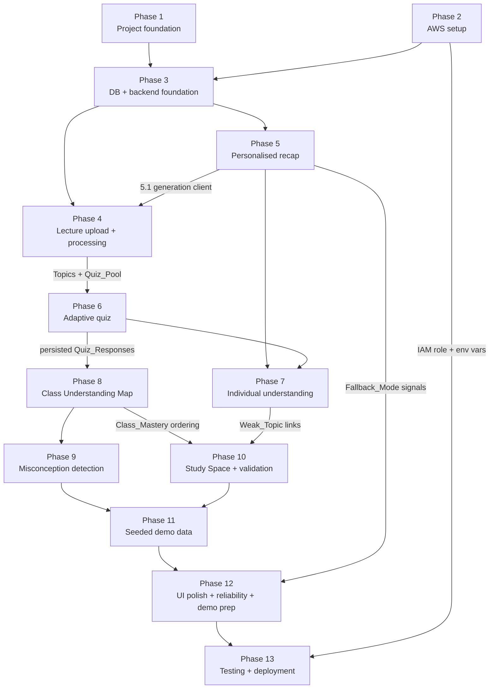

# Implementation Plan: ClassMind MVP

## Overview

One Next.js App Router application in TypeScript. Route Handlers are the whole backend, talking to S3 (Lecture_Material bytes), Bedrock (natural-language generation and Peer_Explanation assessment), DynamoDB (single table `classmind`) and CloudWatch Logs (Fallback_Mode records). All scoring, aggregation, selection and gating logic lives in pure functions under `lib/domain/` with no AWS dependency.

The plan is ordered so that the learner-facing demo journey is buildable as early as possible:

**Join Demo Class → Choose Learning Profile → Personalised Recap → Adaptive Quiz → Individual Understanding → Class Understanding Map → Common Misconception → Peer Explanation**

Conventions used below:

- `*` on a checkbox marks a test sub-task. These are optional for a minimum viable build and may be skipped.
- `(optional)` in a task title marks a task that is **not on the demo critical path** and can be deferred if the clock runs out. Deferring one usually costs requirements coverage; the Critical Path section states what is lost.
- **Environment** states whether the task needs live AWS, can run wholly locally, or runs locally against mocked AWS.

## Deviations from design.md

1. **Recap variants are generated on demand, not pre-generated.** design.md Section 18 pre-generates all 15 `(Understanding_Level × Explanation_Style)` Recap variants for the demo. That is overridden. Recaps are generated on first request for a profile combination and cached in DynamoDB at `RECAP#v<n>#<UL>#<ES>` (Requirements 3.5, 3.6, 17.5). The demo warm-up (task 12.9) may prime **only the one or two profile combinations in the demo script** — this primes a cache, it does not pre-generate the variant space.
2. **Instructor administration stays minimal.** The upload pipeline (extraction, source units, Topics, Quiz_Pool) is built because the seed script writes through the same repository functions, but instructor-facing UI polish is deferred and marked `(optional)`.
3. **Study Space has no top-level view.** It renders inside `app/class/[sessionId]/insight/page.tsx`, keeping Requirement 18.1's four named views intact.
4. **Bedrock client lands in Phase 5, so Phase 4's Topic identification depends on it.** Phase 4 first ships a deterministic heading-derived Topic derivation (which doubles as the Fallback_Mode path), so the whole ingest pipeline is testable locally before any Bedrock work exists. This cross-phase edge is shown in the dependency graph.

## Task Dependency Graph



Cross-phase edges worth stating plainly:

- **Phase 5 → Phase 4**: `lib/bedrock/client.ts` (task 5.1) is needed by Bedrock Topic identification (4.6) and Quiz_Pool generation (4.8).
- **Phase 4 → Phase 6**: the adaptive quiz cannot serve items without a Quiz_Pool holding at least 4 valid Quiz_Items per Difficulty_Level.
- **Phase 8 → Phase 10**: Study_Threads are ordered by ascending Class_Mastery, so they reuse `domain/classmap`.
- **Phases 3–10 → Phase 11**: seeding writes through the same repository functions the API uses, so it cannot start until those functions exist.

## Critical Path to a Demoable Build

The minimum subset that produces the end-to-end demo flow:

**1.1, 1.3, 1.4 → 2.1, 2.2, 2.3, 2.5 → 3.1–3.9 → 4.1, 4.2, 4.5, 4.6, 4.8 → 5.1–5.8 → 6.1, 6.3, 6.5, 6.6, 6.7 → 7.1, 7.3, 7.5, 7.6 → 8.1, 8.3, 8.5, 8.6 → 9.1, 9.3, 9.4 → 10.1, 10.2, 10.4, 10.5, 10.6 → 11.1, 11.2, 11.3 → 12.1, 12.4, 12.5, 12.6, 12.9, 12.10 → 13.4, 13.5**

What is lost by deferring the `(optional)` tasks:

| Deferred | Coverage lost |
| --- | --- |
| 4.3, 4.4, 4.7, 4.10, 4.11 | Live Instructor upload path — Requirements 2.1–2.6, 2.8, 16.5. The demo uses the seeded class, so the flow still runs, but the product is incomplete against Requirement 2. |
| 12.3, 12.7, 12.8, 12.11 | Mermaid prose fallback (12.11), keyboard and accessible-name coverage (18.8, 18.9), chat-input audit (18.2), measured latency budgets (Requirement 13). |
| 11.4 | Idempotent re-seed. Recovery from a corrupted rehearsal becomes manual. |
| All `*` tasks | Property-based and integration test coverage of the 32 correctness properties. |

## Tasks

### Phase 1 — Project foundation

- [ ] 1. Project foundation

  - [ ] 1.1 Scaffold the Next.js App Router project in TypeScript
    - **Objective:** Create the single Next.js application with strict TypeScript, the App Router, and the directory skeleton from design.md Sections 3 and 4 so every later task has a home for its files.
    - **Files/components:** `package.json`, `tsconfig.json` (strict mode), `next.config.mjs`, `eslint.config.mjs`, `.gitignore`, `app/layout.tsx`, `app/page.tsx`, empty directories `app/api/`, `app/instructor/`, `app/class/`, `components/`, `hooks/`, `lib/domain/`, `lib/bedrock/`, `lib/ingest/`, `lib/repo/`, `lib/aws/`, `lib/design/`, `scripts/`
    - **Dependencies:** none
    - **Acceptance criteria:**
      - `npm run build` and `npm run lint` both succeed on the empty app.
      - Every Route Handler directory is configured for the Node runtime (not Edge), since PDF parsing and the AWS SDK need Node APIs.
      - `tsconfig.json` sets `strict: true` and a `@/*` path alias to the project root.
    - **Environment:** Local only
    - _Requirements: 18.1_

  - [ ] 1.2 Add the root layout navigation for the four named views
    - **Objective:** Build the persistent shell that names exactly four views — Lecture, Recap, Quiz, Class Insight — with no free-form chat input anywhere.
    - **Files/components:** `app/layout.tsx`, `app/class/[sessionId]/layout.tsx`
    - **Dependencies:** 1.1
    - **Acceptance criteria:**
      - The class layout renders four navigation tabs labelled Lecture, Recap, Quiz, Class Insight.
      - Navigation to any of the four views remains available while any single view shows an error.
      - No text input element exists in either layout.
    - **Environment:** Local only
    - _Requirements: 18.1, 18.2, 18.6_

  - [ ] 1.3 Install and configure the test runner and property-based testing library
    - **Objective:** Set up Vitest as the test runner and fast-check as the property-based testing library so the pure-function tasks in Phases 6–10 can ship their property tests alongside the implementation.
    - **Files/components:** `vitest.config.ts`, `package.json` scripts (`test` running `vitest --run`), `tests/setup.ts`
    - **Dependencies:** 1.1
    - **Acceptance criteria:**
      - `npm test` runs once and exits (no watch mode) with a trivial passing example test.
      - fast-check is importable from a test file under `lib/domain/`.
      - Test files resolve the `@/*` alias.
    - **Environment:** Local only
    - _Requirements: 17.1, 17.2_

  - [ ] 1.4 Define the shared domain types
    - **Objective:** Declare the TypeScript types every layer shares — the glossary entities and the enum sets — so domain, repo and handler code cannot drift on shapes.
    - **Files/components:** `lib/types.ts`
    - **Dependencies:** 1.1
    - **Acceptance criteria:**
      - `UnderstandingLevel` and `ExplanationStyle` are union types over exactly the three and five glossary values.
      - `DifficultyLevel` is `1 | 2 | 3`; `ValidationStatus` is the four-value union; `SourceRef` is `{ kind: "page" | "section" | "lines"; value: string }`.
      - Types exist for `ClassSession`, `LectureMaterial`, `SourceUnit`, `Topic`, `Learner`, `LearnerProfile`, `Recap`, `RecapSection`, `QuizItem`, `AnswerOption`, `QuizSession`, `QuizResponse`, `UnderstandingReport`, `PeerExplanation`, `MisconceptionCandidate`.
    - **Environment:** Local only
    - _Requirements: 3.1, 6.7, 11.1, 14.3_

### Phase 2 — AWS setup

- [ ] 2. AWS setup

  - [ ] 2.1 Create and lock down the S3 bucket
    - **Objective:** Provision the single Lecture_Material bucket with the security and lifecycle posture from design.md Section 7.
    - **Files/components:** `infra/s3-bucket.md` (recorded console steps or CLI commands), `infra/s3-bucket-policy.json`, `infra/s3-cors.json`, `infra/s3-lifecycle.json`
    - **Dependencies:** none
    - **Acceptance criteria:**
      - Bucket `classmind-<accountId>-<region>` exists with Block Public Access fully enabled and SSE-S3 (`AES256`) default encryption.
      - The bucket policy denies requests where `aws:SecureTransport` is `false`.
      - CORS allows `PUT` from the application origin only, which is what the browser presigned upload needs.
      - A lifecycle rule expires objects under `sessions/` after 30 days; bucket versioning is off.
    - **Environment:** Requires AWS
    - _Requirements: 2.1_

  - [ ] 2.2 Create the single DynamoDB table
    - **Objective:** Provision table `classmind` with the composite key schema that every access pattern in design.md Section 8 relies on.
    - **Files/components:** `infra/dynamodb-table.md`
    - **Dependencies:** none
    - **Acceptance criteria:**
      - Table `classmind` exists with partition key `PK` (String) and sort key `SK` (String), on-demand billing, no GSI.
      - The table is in the same region as the bucket and the Bedrock model.
      - A recorded `PutItem` / `Query` smoke command succeeds against the table.
    - **Environment:** Requires AWS
    - _Requirements: 8.1, 17.5_

  - [ ] 2.3 Enable Bedrock model access in the target region — start this first, it has lead time
    - **Objective:** Request and confirm access to the Claude Haiku tier model in the demo account and region, and record the exact model or inference-profile ID the application will use.
    - **Files/components:** `infra/bedrock-access.md`
    - **Dependencies:** none
    - **Acceptance criteria:**
      - Model access is granted for the chosen Haiku model in the target region; the request is submitted before any other Phase 2 work because approval is not instantaneous.
      - `aws bedrock list-foundation-models` output confirms the resolved model ID (or the `us.`-prefixed cross-region inference profile ID) and it is recorded for `BEDROCK_MODEL_ID`.
      - A one-off `Converse` call with a 10-token prompt returns successfully, proving no `AccessDeniedException`.
    - **Environment:** Requires AWS
    - _Requirements: 17.3_

  - [ ] 2.4 Author the least-privilege IAM policy for the application role
    - **Objective:** Write the single policy the hosting service role carries, exactly as scoped in design.md Section 19.
    - **Files/components:** `infra/app-role-policy.json`, `infra/iam.md`
    - **Dependencies:** 2.1, 2.2, 2.3
    - **Acceptance criteria:**
      - S3 statements grant only `PutObject`, `GetObject`, `DeleteObject` on `.../sessions/*` and `ListBucket` conditioned on the `sessions/` prefix.
      - DynamoDB statements grant only `GetItem`, `PutItem`, `UpdateItem`, `DeleteItem`, `Query`, `BatchWriteItem`, `BatchGetItem`, `TransactWriteItems` on the `classmind` table ARN — `Scan` is absent.
      - Bedrock statements name the specific model ARN plus the inference-profile ARN if one is used; no `bedrock:*`.
      - No wildcard resource appears in the policy.
    - **Environment:** Requires AWS
    - _Requirements: 16.5, 17.3_

  - [ ] 2.5 Wire local environment configuration and fail-fast validation
    - **Objective:** Define the server-only environment variables and a module that validates them at startup, so a missing variable surfaces immediately rather than as a runtime AWS error.
    - **Files/components:** `.env.local.example`, `lib/env.ts`, `README.md` (setup section)
    - **Dependencies:** 1.1, 2.1, 2.2, 2.3
    - **Acceptance criteria:**
      - `lib/env.ts` reads and validates `AWS_REGION`, `CLASSMIND_TABLE`, `CLASSMIND_BUCKET`, `BEDROCK_MODEL_ID`, `APP_ORIGIN` and throws a named error listing any missing variable.
      - No variable is prefixed `NEXT_PUBLIC_`; `lib/env.ts` is imported only from server code.
      - Local development resolves credentials from the AWS profile chain, never from checked-in keys; `.env.local` is git-ignored.
      - A `dev-` Class_Session prefix convention is documented so local runs share the table without colliding with the demo session.
    - **Environment:** Requires AWS
    - _Requirements: 16.2_

### Phase 3 — Database and backend foundation

- [ ] 3. Database and backend foundation

  - [ ] 3.1 Build the AWS client modules and the structured logger
    - **Objective:** Create one lazily constructed client per service plus the CloudWatch-bound structured logger, so no handler ever constructs an SDK client itself.
    - **Files/components:** `lib/aws/ddb.ts`, `lib/aws/s3.ts`, `lib/aws/bedrock.ts`, `lib/aws/logger.ts`
    - **Dependencies:** 2.5
    - **Acceptance criteria:**
      - Each module exports a single memoised client built from `lib/env.ts`, reused across requests.
      - `lib/aws/ddb.ts` exports a DocumentClient configured to remove undefined values.
      - `lib/aws/logger.ts` exports `logFallback` and `logError`, each writing one single-line JSON record via `console.error` with `level`, `event`, `requestId` and `ts` fields.
      - No module in `lib/aws/` is importable from a Client Component (guarded by a `server-only` import).
    - **Environment:** Local with mocked AWS
    - _Requirements: 12.10_

  - [ ] 3.2 Implement the single-table key helpers
    - **Objective:** Centralise every `PK`/`SK` string construction and parse from design.md Section 8, so key format lives in exactly one file.
    - **Files/components:** `lib/repo/keys.ts`, `lib/repo/keys.test.ts`
    - **Dependencies:** 1.4
    - **Acceptance criteria:**
      - Builders exist for every entity: `META`, `JOIN#`, `MATERIAL#v<n>`, `UNIT#v<n>#<idx4>`, `TOPIC#v<n>#<order2>#<slug>`, `LEARNER#`, `PROFILE#`, `RECAP#v<n>#<UL>#<ES>`, `QITEM#v<n>#<d>#<itemId>`, `QSESS#<lid>#<qsid>`, `RESP#<qsid>#<seq2>`, `REPORT#<lid>#<qsid>`, `EXPL#<topicId>#<ts>#<eid>`, `MISC#v<n>#<itemId>#<optionId>`.
      - Prefix builders exist for every `begins_with` query used by the access patterns, including the class-wide `RESP#` prefix.
      - Unit indexes and response sequences are zero-padded so lexicographic sort equals numeric sort; a round-trip build-then-parse test covers each builder.
    - **Environment:** Local only
    - _Requirements: 8.1, 15.2_

  - [ ] 3.3 Implement the session, learner and profile repository
    - **Objective:** Provide the reads and writes for Class_Session creation, Join_Code resolution, Learner registration, membership verification and Learner_Profile upsert.
    - **Files/components:** `lib/repo/session.ts`
    - **Dependencies:** 3.1, 3.2
    - **Acceptance criteria:**
      - `createSession` issues one `TransactWriteItems` putting `CS#<sid>/META` and `JOIN#<code>` with `attribute_not_exists(PK)` on the pointer, so a duplicate Join_Code fails the write rather than overwriting.
      - `resolveJoinCode` returns the session or null; `registerLearner` writes `LEARNER#<lid>` inside the session partition; `assertLearnerInSession` returns false when the item is absent.
      - `putProfile` and `getProfile` upsert and read `PROFILE#<lid>`.
      - The Instructor token is stored only as a hash on the `META` item, never in plaintext.
    - **Environment:** Local with mocked AWS
    - _Requirements: 1.1, 1.2, 1.3, 1.7, 3.3, 16.3, 16.4_

  - [ ] 3.4 Implement the remaining repository modules
    - **Objective:** Create the typed access functions for material, units, Topics, pool, quiz, reports, explanations and misconception cache, matching the numbered access patterns in design.md Section 8.
    - **Files/components:** `lib/repo/material.ts`, `lib/repo/pool.ts`, `lib/repo/quiz.ts`, `lib/repo/report.ts`, `lib/repo/explanation.ts`, `lib/repo/misconception.ts`
    - **Dependencies:** 3.2, 3.3
    - **Acceptance criteria:**
      - Every function is a key lookup, a single-partition `Query` with `begins_with`, a `BatchWriteItem` or a `TransactWriteItems` — no `Scan` anywhere in the codebase.
      - `quiz.listAllClassResponses` performs one `Query` on `PK = CS#<sid>` with the `RESP#` prefix, returning every Quiz_Response in the Class_Session.
      - Item writes larger than 25 entries (units, Topics, Quiz_Items) are chunked for `BatchWriteItem` with unprocessed-item retry.
      - Each module exports plain domain objects, not raw DynamoDB items, and contains no domain arithmetic.
    - **Environment:** Local with mocked AWS
    - _Requirements: 2.4, 2.7, 5.7, 6.4, 8.1, 10.1, 17.5_

  - [ ] 3.5 Build the uniform handler pipeline, error envelope and error code table
    - **Objective:** Implement the shared wrapper that runs every Route Handler through parse → authorise → validate → repo read → domain compute → generate → repo write → project → respond, and the single error shape all views render.
    - **Files/components:** `lib/http/pipeline.ts`, `lib/http/errors.ts`, `lib/http/auth.ts`
    - **Dependencies:** 3.3, 3.4
    - **Acceptance criteria:**
      - `errors.ts` declares every code from design.md Section 16 with its HTTP status: `SESSION_NOT_FOUND`, `INVALID_DISPLAY_NAME`, `UNSUPPORTED_EXTENSION`, `MATERIAL_TOO_LARGE`, `NO_READABLE_TEXT`, `PROFILE_REQUIRED`, `INVALID_PROFILE`, `POOL_UNAVAILABLE`, `EXPLANATION_LENGTH`, `NOT_YOUR_REPORT`, `LEARNER_NOT_IN_SESSION`, `INSTRUCTOR_TOKEN_REQUIRED`, `INTERNAL`.
      - Every failure serialises as `{ "error": { "code", "message", "field?" } }`; `INTERNAL` carries a request id and leaks no internals.
      - `auth.ts` provides `requireLearner` (validates `x-learner-id` against session membership) and `requireInstructor` (constant-time compare of `x-instructor-token` against the stored hash).
      - `project` is a mandatory named stage, so a handler cannot return a repo object directly.
    - **Environment:** Local with mocked AWS
    - _Requirements: 16.4, 16.5, 18.6_

  - [ ] 3.6 Implement server-side input validation
    - **Objective:** Write the pure validators for every client-supplied value, so no handler trusts the client for lengths, enum membership or sizes.
    - **Files/components:** `lib/domain/validate-input.ts`, `lib/domain/validate-input.test.ts`
    - **Dependencies:** 1.4
    - **Acceptance criteria:**
      - Validators cover Display_Name (1–30 characters), Join_Code shape (6 alphanumeric), Understanding_Level and Explanation_Style membership, file extension set `{pdf, txt, md, markdown}`, declared byte size ceiling of 20 MB, and Peer_Explanation length (20–1500 characters).
      - Each validator returns a typed result naming the offending field, mapped to the matching error code.
      - Tests cover both boundaries of every range (0/1/30/31 characters, 19/20/1500/1501 characters, exactly 20 MB and one byte over).
    - **Environment:** Local only
    - _Requirements: 1.3, 2.2, 2.3, 3.2, 10.3, 16.4_

  - [ ] 3.7 Implement the create-session endpoint
    - **Objective:** Ship `POST /api/sessions`, generating a unique 6-character Join_Code and issuing the Instructor token.
    - **Files/components:** `app/api/sessions/route.ts`, `lib/domain/joincode.ts`
    - **Dependencies:** 3.3, 3.5, 3.6
    - **Acceptance criteria:**
      - The response returns `{sessionId, joinCode, instructorToken}`; the Join_Code is 6 alphanumeric characters.
      - A conditional-put collision on the `JOIN#` pointer triggers regeneration and retry up to a fixed attempt cap, so a returned Join_Code is always unique across Class_Sessions.
      - The Instructor token is returned once and stored only as a hash.
    - **Environment:** Local with mocked AWS
    - _Requirements: 1.1, 1.2, 16.5_

  - [ ] 3.8 Implement the join-session endpoint
    - **Objective:** Ship `POST /api/sessions/join`, admitting a Learner on a Join_Code plus Display_Name with no password, email or identity provider.
    - **Files/components:** `app/api/sessions/join/route.ts`
    - **Dependencies:** 3.3, 3.5, 3.6
    - **Acceptance criteria:**
      - A matching Join_Code creates a random 128-bit opaque Learner_Id scoped to that session partition and returns `{sessionId, learnerId, name, material, topics[]}`.
      - An unrecognised Join_Code returns 404 `SESSION_NOT_FOUND` with a message naming the code as unrecognised.
      - A Display_Name outside 1–30 characters returns 400 `INVALID_DISPLAY_NAME`.
      - The Learner_Id contains no personal data and no request path accepts it for a different Class_Session.
    - **Environment:** Local with mocked AWS
    - _Requirements: 1.3, 1.4, 16.1, 16.2, 16.3_

  - [ ] 3.9 Build the join landing page and the Learner_Id local-storage hook
    - **Objective:** Ship the entry page where the presenter enters the demo class code and a Display_Name, reusing a stored Learner_Id when one exists for that session.
    - **Files/components:** `app/page.tsx`, `hooks/useLearnerId.ts`, `hooks/useInstructorToken.ts`
    - **Dependencies:** 3.8, 1.2
    - **Acceptance criteria:**
      - Joining writes `classmind:learner:<sessionId>` to local storage and every later request sends it as `x-learner-id`.
      - When a Learner_Id for the session is already in local storage, the app reuses it instead of creating a new Learner_Id.
      - The join form is keyboard-operable, every control has an accessible name, and a rejected code renders inline without leaving the page.
      - The instructor token, when present, is stored under `classmind:instructor:<sessionId>` and sent as `x-instructor-token`.
    - **Environment:** Local with mocked AWS
    - _Requirements: 1.5, 1.6, 16.1, 18.6, 18.8_

### Phase 4 — Lecture upload and processing

Functional but deliberately unpolished. The seeded demo class (Phase 11) means the live upload path is off the demo critical path, but the pipeline it feeds — Source_Text, source units, Topics, Quiz_Pool — is squarely on it, because `scripts/seed-demo.ts` writes through these same modules.

- [ ] 4. Lecture upload and processing

  - [ ] 4.1 Implement text extraction for PDF, TXT and Markdown
    - **Objective:** Turn an uploaded file buffer into Source_Text with per-page or per-block structure, using in-process parsing only — no OCR, no Textract.
    - **Files/components:** `lib/ingest/extract.ts`, `lib/ingest/extract.test.ts`, `tests/fixtures/` (a small PDF, a TXT and a Markdown file)
    - **Dependencies:** 1.4, 1.3
    - **Acceptance criteria:**
      - PDF extraction returns per-page text via the pdf.js text layer; Markdown returns per-heading blocks; TXT returns heading-like blocks or fixed 40-line blocks.
      - The function reports a total `charCount` and never throws on a malformed file — it returns an extraction failure result.
      - An image-only PDF fixture yields fewer than 200 characters, which the caller treats as unprocessable.
    - **Environment:** Local only
    - _Requirements: 2.4, 2.5_

  - [ ] 4.2 Implement source-unit segmentation with Source_References
    - **Objective:** Convert extracted structure into stable numbered source units, each carrying the Source_Reference that citations resolve to.
    - **Files/components:** `lib/ingest/units.ts`, `lib/ingest/units.test.ts`
    - **Dependencies:** 4.1
    - **Acceptance criteria:**
      - Each unit gets a zero-padded stable index and a `SourceRef` of `{kind:"page", value:"p. 7"}`, `{kind:"section", value:"§ Name"}` or `{kind:"lines", value:"lines 81–120"}` by input type.
      - Units are capped at roughly 1,200 characters; an oversized page or section splits into `p. 7 (a)`, `p. 7 (b)` with distinct indexes.
      - Segmentation is deterministic: the same input file yields the same unit indexes and references on every run.
    - **Environment:** Local only
    - _Requirements: 2.4, 14.3_

  - [ ] 4.3 Implement the presigned upload-URL endpoint (optional)
    - **Objective:** Ship `POST /api/sessions/{sid}/material/upload-url`, gating extension and size server-side and returning a tightly scoped presigned PUT so 20 MB of bytes never traverse the compute path.
    - **Files/components:** `app/api/sessions/[sid]/material/upload-url/route.ts`
    - **Dependencies:** 3.5, 3.6, 2.1
    - **Acceptance criteria:**
      - Requires a valid Instructor token; otherwise 403 `INSTRUCTOR_TOKEN_REQUIRED`.
      - An extension outside `{PDF, TXT, Markdown}` returns 400 `UNSUPPORTED_EXTENSION` with the accepted list in the message and no URL is presigned; a declared size above 20 MB returns 400 `MATERIAL_TOO_LARGE` stating the limit.
      - The presigned PUT expires in 5 minutes, is pinned to key `sessions/<sid>/material/v<version>/<uuid>.<ext>`, and carries a `content-length-range` of 1 byte to 20 MB.
    - **Environment:** Requires AWS
    - _Requirements: 2.1, 2.2, 2.3, 16.5_

  - [ ] 4.4 Implement the material confirm endpoint (optional)
    - **Objective:** Ship `POST /api/sessions/{sid}/material/confirm` to fetch the stored object, extract Source_Text, persist source units and advance the named stages.
    - **Files/components:** `app/api/sessions/[sid]/material/confirm/route.ts`
    - **Dependencies:** 4.2, 4.3, 3.4
    - **Acceptance criteria:**
      - Writes the `MATERIAL#v<n>` item with `status: processing` and stage values in order: Storing material → Extracting text → Identifying topics → Generating quiz.
      - Fewer than 200 extracted characters marks the material `unprocessable` and returns 422 `NO_READABLE_TEXT` stating that readable text was not found.
      - On success, source units are persisted by `BatchWriteItem`, Topics are identified, and the response returns `{status, stage, charCount, topics[], poolStatus:"pending"}`.
      - Storage, extraction and Topic identification for a document of 20 pages or fewer complete within 15 seconds, measured and recorded.
    - **Environment:** Requires AWS
    - _Requirements: 2.1, 2.4, 2.5, 2.6, 13.1_

  - [ ] 4.5 Implement deterministic Topic derivation from unit headings
    - **Objective:** Derive 3–8 Topics from unit headings or page groups with no Bedrock call, giving both a testable baseline and the Fallback_Mode path for Topic identification.
    - **Files/components:** `lib/ingest/topics.ts`, `lib/ingest/topics.test.ts`
    - **Dependencies:** 4.2
    - **Acceptance criteria:**
      - Always returns between 3 and 8 Topics, each with at least one in-range unit index, for any set of units producing at least 200 characters.
      - Topic names are trimmed to 60 characters, duplicates merged, and ordering is stable across runs.
      - The function makes no network call of any kind.
    - **Environment:** Local only
    - _Requirements: 2.7, 12.9_

  - [ ] 4.6 Implement Bedrock Topic identification with server-side post-conditions
    - **Objective:** Add the `topics` generation task that names 3–8 Topics with unit indexes, falling back to 4.5's derivation when generation fails.
    - **Files/components:** `lib/bedrock/tasks/topics.ts`
    - **Dependencies:** 5.1, 5.2, 5.3, 4.5
    - **Acceptance criteria:**
      - The response is clamped to 3–8 Topics, duplicate names merged, and any Topic whose unit indexes are all out of range is dropped.
      - Fewer than 3 surviving Topics triggers exactly one repair request before Fallback_Mode.
      - Fallback_Mode substitutes the deterministic derivation from 4.5 and persists it, so downstream Recap, Quiz and Class Insight paths remain reachable.
    - **Environment:** Local with mocked AWS
    - _Requirements: 2.7, 12.2, 12.9, 14.1, 14.2_

  - [ ] 4.7 Implement the material status endpoint (optional)
    - **Objective:** Ship `GET /api/sessions/{sid}/material/status` so the client can poll extraction stage, Topic list, pool status and degraded tasks.
    - **Files/components:** `app/api/sessions/[sid]/material/status/route.ts`
    - **Dependencies:** 4.4, 3.5
    - **Acceptance criteria:**
      - Readable by the Instructor or any Learner of the session; returns `{status, stage, topics[], poolStatus, degraded[]}`.
      - The stage value names the current processing stage while extraction and Topic identification run.
      - The endpoint issues no Bedrock call.
    - **Environment:** Local with mocked AWS
    - _Requirements: 2.6, 12.9, 13.8_

  - [ ] 4.8 Implement Quiz_Pool generation with validation and level-scoped regeneration
    - **Objective:** Ship `POST /api/sessions/{sid}/pool`, generating the Quiz_Pool once per Lecture_Material, discarding malformed Quiz_Items and retaining the pool for every Quiz_Session.
    - **Files/components:** `app/api/sessions/[sid]/pool/route.ts`, `lib/bedrock/tasks/pool.ts`
    - **Dependencies:** 5.1, 5.2, 5.3, 5.4, 4.6, 3.4
    - **Acceptance criteria:**
      - A Quiz_Item is discarded unless it holds exactly 4 Answer_Options, exactly 1 correct Answer_Option, a Topic within the session Topics, and an in-range unit index resolving to a Source_Reference; every Distractor carries a non-empty Misconception_Label.
      - Fewer than 2 valid items at a Difficulty_Level triggers exactly one regeneration request restricted to that level; the target is at least 4 valid items per level for levels 1 to 3.
      - The endpoint is idempotent via a conditional status transition on `poolStatus`, so a duplicate call from the Instructor page and the Quiz view cannot double-generate.
      - On terminal failure with no retained pool, `poolStatus` becomes `unavailable` and the response says so rather than erroring the whole session.
    - **Environment:** Local with mocked AWS
    - _Requirements: 5.1, 5.2, 5.3, 5.4, 5.5, 5.6, 5.7, 12.4, 12.5, 14.1_

  - [ ]* 4.9 Write the property test for Quiz_Item well-formedness
    - **Property 24: Quiz item well-formedness** — for all Quiz_Items retained in a Quiz_Pool, the item holds exactly 4 Answer_Options, exactly 1 correct Answer_Option, a Topic within the Class_Session Topics, and a resolvable Source_Reference.
    - **Objective:** Generate arbitrary candidate pool payloads, including malformed ones, and assert the validator retains only well-formed Quiz_Items.
    - **Files/components:** `lib/bedrock/tasks/pool.test.ts`
    - **Dependencies:** 4.8
    - **Acceptance criteria:**
      - fast-check generators produce items with 3, 4 and 5 options, 0, 1 and 2 correct options, unknown Topic ids and out-of-range unit indexes.
      - Every retained item satisfies the four conditions; every discarded item violates at least one.
    - **Environment:** Local only
    - _Requirements: 5.3, 5.5, 14.3_

  - [ ] 4.10 Implement material replacement and version purge (optional)
    - **Objective:** Support a second upload to a session by writing version `n+1` then purging version `n` across DynamoDB and S3.
    - **Files/components:** `lib/repo/material.ts` (purge functions), `app/api/sessions/[sid]/material/confirm/route.ts` (replacement branch)
    - **Dependencies:** 4.4, 3.4
    - **Acceptance criteria:**
      - Replacement deletes the previous Lecture_Material, Topics, Quiz_Pool, Quiz_Sessions, Understanding_Reports, misconception clarifications and Peer_Explanations for the session.
      - `materialVersion` on the `META` item flips last, so a partially built version is never visible to a reader.
      - The old S3 prefix is deleted after the DynamoDB purge completes.
    - **Environment:** Requires AWS
    - _Requirements: 2.8_

  - [ ] 4.11 Build the minimal instructor page (optional)
    - **Objective:** Ship a functional, unpolished Instructor page that creates a session, uploads a file, shows stage progress, the Topic list, the Join_Code and pool status.
    - **Files/components:** `app/instructor/[sessionId]/page.tsx`, `components/StageProgress.tsx` (first use)
    - **Dependencies:** 4.3, 4.4, 4.7, 4.8
    - **Acceptance criteria:**
      - The page performs the presigned PUT from the browser, calls confirm, then calls `POST /pool` as a continuation and polls status.
      - Rejected uploads render the returned error message inline; the Join_Code is displayed for sharing.
      - Cosmetic refinement is explicitly out of scope for this task.
    - **Environment:** Requires AWS
    - _Requirements: 2.6, 2.7, 13.8, 18.6_

### Phase 5 — Personalised recap

The Recap is the first feature that needs Bedrock, so the generation client, the five task schemas, the prompt structure and the citation resolver are built here and reused by Phases 4, 7, 9 and 10.

- [ ] 5. Personalised recap

  - [ ] 5.1 Build the Bedrock generation client
    - **Objective:** Implement the single `generate(task, input, schema)` entry point with per-task timeout, at most 2 retries, at most 1 repair request, schema validation, Fallback_Mode signalling and the CloudWatch record.
    - **Files/components:** `lib/bedrock/client.ts`, `lib/bedrock/client.test.ts`
    - **Dependencies:** 3.1, 2.3
    - **Acceptance criteria:**
      - Returns a discriminated result `{ok:true, value}` or `{ok:false, reason}` where reason is drawn from the closed set `timeout | throttled | access_denied | transport | schema_invalid_after_repair | unresolvable_citation`.
      - Transport, throttle and timeout failures retry at most twice with delays of 500 ms then 1,500 ms; a schema-invalid response triggers at most one repair request echoing the validation errors.
      - Nothing from a response that fails schema validation is returned to the caller, so no such content can be persisted.
      - Entering Fallback_Mode writes one structured CloudWatch record carrying task name, Class_Session identifier, failure reason, attempt count and request id.
      - Per-task timeouts and `maxTokens` match design.md Section 6 (`topics` 8 s, `recap` 16 s, `pool` 25 s, `guidance` 7 s, `clarify` 7 s, `assess` 10 s), with `temperature: 0`.
    - **Environment:** Local with mocked AWS
    - _Requirements: 12.1, 12.2, 12.10, 14.4, 17.3_

  - [ ] 5.2 Declare the Bedrock output schemas
    - **Objective:** Define every task's output schema once, so the validator and the `<schema>` block in the prompt cannot drift apart.
    - **Files/components:** `lib/bedrock/schemas.ts`, `lib/bedrock/schemas.test.ts`
    - **Dependencies:** 1.4
    - **Acceptance criteria:**
      - Schemas exist for `topics`, `recap`, `pool`, `guidance`, `clarify` and `assess`, exactly as tabulated in design.md Section 6, with all fields required and additional properties disallowed.
      - Each schema is usable both as a runtime validator and as the JSON text embedded in the prompt.
      - The `assess` schema restricts `status` to the three-value enum, so any other answer is a validation failure.
    - **Environment:** Local only
    - _Requirements: 14.4_

  - [ ] 5.3 Build the prompt templates with delimited untrusted data
    - **Objective:** Implement the shared four-part prompt shape — system rules, delimited `<source_units>`, task block, schema block — with instructor and learner text declared as data rather than instructions.
    - **Files/components:** `lib/bedrock/prompts.ts`, `lib/bedrock/prompts.test.ts`
    - **Dependencies:** 5.2, 4.2
    - **Acceptance criteria:**
      - Every prompt includes the Source_Text of the session as numbered units and instructs the model to derive output only from those units and to report missing coverage instead of using outside knowledge.
      - Content inside `<source_units>` and `<peer_explanation>` is declared as data, with any instruction inside those tags to be ignored.
      - Citations are requested as unit indexes only; the prompt forbids inventing an index.
      - A test asserts that a unit whose text contains an injected instruction is still wrapped and never promoted into the system block.
    - **Environment:** Local only
    - _Requirements: 14.1, 14.2_

  - [ ] 5.4 Implement unit-index to Source_Reference resolution
    - **Objective:** Resolve every model-returned unit index against persisted units, rejecting out-of-range indexes so a citation can never be fabricated.
    - **Files/components:** `lib/bedrock/resolve.ts`, `lib/bedrock/resolve.test.ts`
    - **Dependencies:** 4.2, 5.2
    - **Acceptance criteria:**
      - `resolveRefs(unitIdxs, units)` returns only Source_References for in-range indexes and reports which indexes were unresolvable.
      - A payload whose citations are all unresolvable yields the `unresolvable_citation` failure reason.
      - Resolution is pure and performs no I/O.
    - **Environment:** Local only
    - _Requirements: 14.3, 14.5_

  - [ ] 5.5 Implement the Learner_Profile endpoint and picker
    - **Objective:** Ship `PUT /api/sessions/{sid}/profile` and the picker presenting three Understanding_Level and five Explanation_Style choices.
    - **Files/components:** `app/api/sessions/[sid]/profile/route.ts`, `components/ProfilePicker.tsx`, `app/class/[sessionId]/lecture/page.tsx`
    - **Dependencies:** 3.3, 3.5, 3.6, 3.9
    - **Acceptance criteria:**
      - A value outside either set returns 400 `INVALID_PROFILE`; a valid pair persists as the Learner_Profile for that Learner_Id and Class_Session.
      - The Lecture view presents all three levels and all five styles as selectable, keyboard-operable controls with accessible names, and requires one of each before a Recap can be requested.
      - Changing either value persists the new profile and triggers a Recap request for the new combination.
    - **Environment:** Local with mocked AWS
    - _Requirements: 3.1, 3.2, 3.3, 3.4, 18.8_

  - [ ] 5.6 Implement the Recap generation task and post-validation
    - **Objective:** Build the `recap` task with the level and style directives, and the server-side checks on the returned Recap.
    - **Files/components:** `lib/bedrock/tasks/recap.ts`, `lib/bedrock/tasks/recap.test.ts`
    - **Dependencies:** 5.1, 5.2, 5.3, 5.4
    - **Acceptance criteria:**
      - The prompt carries the correct directive for each of the three Understanding_Levels and the five Explanation_Styles, exactly as mapped in design.md Section 11, including the prose form requirement for Visual_Structured and the no-image-service constraint.
      - Post-validation asserts one Recap_Section per identified Topic and 3–7 single-sentence Key_Takeaways; a section with no resolvable Source_Reference is marked unverified rather than dropped.
      - Style post-checks (word counts, example marker, numbered steps, artefact kind, non-empty prose form) produce a `styleWarning` rather than discarding a section.
      - A Topic the Source_Text does not cover is reported as uncovered instead of being filled in.
    - **Environment:** Local with mocked AWS
    - _Requirements: 4.1, 4.2, 4.3, 4.4, 4.5, 4.6, 4.7, 4.8, 4.9, 4.10, 4.11, 4.12, 4.13, 4.14, 4.15, 14.2, 14.3_

  - [ ] 5.7 Implement the Recap endpoint with on-demand generation and DynamoDB caching
    - **Objective:** Ship `GET /api/sessions/{sid}/recap`, returning a retained Recap when one exists for the profile combination and generating on demand when it does not.
    - **Files/components:** `app/api/sessions/[sid]/recap/route.ts`
    - **Dependencies:** 5.6, 3.4, 5.5
    - **Acceptance criteria:**
      - A cache hit on `RECAP#v<n>#<UL>#<ES>` returns the retained Recap with no Bedrock request, within 1 second.
      - A cache miss generates, then persists under the same key, so a repeated view of the same profile combination needs no new Bedrock request; generation returns within 20 seconds.
      - A request before both profile selections exist returns 400 `PROFILE_REQUIRED`.
      - Every returned section carries its Source_References, or an unverified flag when none resolved.
      - Variants are never pre-generated in bulk — this endpoint is the only writer of the Recap cache.
    - **Environment:** Local with mocked AWS
    - _Requirements: 3.5, 3.6, 4.1, 13.2, 13.3, 14.5, 17.5_

  - [ ] 5.8 Build the Recap view
    - **Objective:** Render the Recap as a Key_Takeaways list followed by one collapsible panel per Recap_Section, with structured artefacts and their prose alternatives.
    - **Files/components:** `app/class/[sessionId]/recap/page.tsx`, `components/RecapSection.tsx`, `components/StructuredArtefact.tsx`
    - **Dependencies:** 5.7, 1.2
    - **Acceptance criteria:**
      - Key_Takeaways render as a list above the sections; each section is a collapsible panel headed by the Topic name and shows its Source_Reference.
      - A section marked unverified renders a visible unverified indicator.
      - `StructuredArtefact` renders a labelled table, an ordered pipeline or a Mermaid diagram from persisted text, always accompanied by the persisted prose form.
      - The page is assembled server-side so a retained Recap renders in one round trip.
    - **Environment:** Local with mocked AWS
    - _Requirements: 4.13, 4.15, 4.16, 14.5, 18.9_

  - [ ] 5.9 Implement the Recap Fallback_Mode source-extract response
    - **Objective:** Return a Topic-scoped source-extract Recap when Recap generation enters Fallback_Mode, including under the Visual_Structured style.
    - **Files/components:** `lib/bedrock/tasks/recap.ts` (fallback builder), `app/api/sessions/[sid]/recap/route.ts` (fallback branch)
    - **Dependencies:** 5.7
    - **Acceptance criteria:**
      - The fallback response carries `mode:"source_extract"` with the Topic list and 2–3 verbatim source units per Topic, each with its real Source_Reference, labelled as a source extract rather than a generated Recap.
      - Artefacts are suppressed and content is prose-only even when the Explanation_Style is Visual_Structured.
      - Fallback Recaps are not written to the `RECAP#` key, so a later successful generation still populates the cache.
    - **Environment:** Local with mocked AWS
    - _Requirements: 12.3, 12.12_

  - [ ]* 5.10 Write the property tests for personalisation and grounding
    - **Property 25: Reference resolvability** — every Source_Reference attached to persisted content resolves to an existing location in the Source_Text. **Validates: Requirements 14.3**
    - **Property 26: Schema rejection** — for every Bedrock response failing schema validation, no content from the response is persisted. **Validates: Requirements 14.4**
    - **Property 29: Style conformance** — every Recap_Section satisfies the structural constraint of the selected Explanation_Style. **Validates: Requirements 4.8–4.12**
    - **Property 30: Profile domain** — every persisted Learner_Profile lies within the two declared sets, giving at most 15 retained Recap variants. **Validates: Requirements 3.2, 3.5**
    - **Property 31: Cache key totality** — the retained Recap lookup is a total function of (Class_Session, Understanding_Level, Explanation_Style), so one triple never resolves to two Recaps. **Validates: Requirements 3.5, 3.6**
    - **Property 32: Visual fallback availability** — every Visual_Structured Recap_Section has a persisted, retrievable prose form. **Validates: Requirements 4.13**
    - **Objective:** Encode the six properties above as fast-check tests over the resolver, the schema validator, the style post-checks and the cache-key builder.
    - **Files/components:** `lib/bedrock/resolve.test.ts`, `lib/bedrock/schemas.test.ts`, `lib/bedrock/tasks/recap.test.ts`, `lib/repo/keys.test.ts`
    - **Dependencies:** 5.4, 5.6, 5.7, 5.9
    - **Acceptance criteria:**
      - Each property is a named test asserting over generated inputs, not a single example.
      - The cache-key test enumerates all 15 combinations and asserts distinct keys and a stable mapping.
      - The schema-rejection test asserts the repo write function is never called for an invalid payload.
    - **Environment:** Local only
    - _Requirements: 3.5, 3.6, 4.8, 4.9, 4.10, 4.11, 4.12, 4.13, 14.3, 14.4_

### Phase 6 — Adaptive quiz

Every function in this phase is deterministic and Bedrock-free.

- [ ] 6. Adaptive quiz

  - [ ] 6.1 Implement the difficulty transition functions
    - **Objective:** Write `initialState`, `nextState` and `replay` as pure functions implementing the state table in design.md Section 12, with Current_Difficulty derived by folding over persisted Quiz_Responses.
    - **Files/components:** `lib/domain/difficulty.ts`
    - **Dependencies:** 1.4
    - **Acceptance criteria:**
      - `initialState()` returns Current_Difficulty 2 with an empty run.
      - Two consecutive correct responses raise the difficulty by 1 and reset the consecutive count; two consecutive incorrect responses lower it by 1 and reset the count; a run whose kind switches does not move the difficulty.
      - Current_Difficulty is clamped to 1–3 and `replay` is the only source of truth, so the value stored on the Quiz_Session item is a cache of the fold.
      - The module imports nothing from `lib/aws/`, `lib/repo/` or `lib/bedrock/`.
    - **Environment:** Local only
    - _Requirements: 6.1, 6.5, 6.6, 6.7, 6.8, 17.1_

  - [ ]* 6.2 Write the property tests for difficulty transitions
    - **Property 1: Bounded difficulty invariant** — Current_Difficulty stays within 1 to 3 for all response sequences. **Validates: Requirements 6.7**
    - **Property 2: Single-step invariant** — Current_Difficulty changes by at most 1 between consecutive responses. **Validates: Requirements 6.5, 6.6**
    - **Property 3: Monotone ascent** — for all-correct sequences, Current_Difficulty is non-decreasing. **Validates: Requirements 6.5**
    - **Property 4: Monotone descent** — for all-incorrect sequences, Current_Difficulty is non-increasing. **Validates: Requirements 6.6**
    - **Property 5: Determinism** — replaying a sequence yields the same Current_Difficulty and the same served item order. **Validates: Requirements 6.8, 17.2**
    - **Objective:** Encode the five properties as fast-check tests over arbitrary boolean correctness sequences.
    - **Files/components:** `lib/domain/difficulty.test.ts`
    - **Dependencies:** 6.1
    - **Acceptance criteria:**
      - Each property is its own named test over generated sequences of length 0 to 50.
      - The worked six-response trace from design.md Section 12 is included as an explicit example test.
    - **Environment:** Local only
    - _Requirements: 6.5, 6.6, 6.7, 6.8, 17.2_

  - [ ] 6.3 Implement deterministic Quiz_Item selection
    - **Objective:** Write `selectNextItem` choosing an unserved item at the Current_Difficulty, walking outwards to the nearest level when none remains, and ordering candidates by a fixed total order.
    - **Files/components:** `lib/domain/difficulty.ts` (selection section) or `lib/domain/selection.ts`
    - **Dependencies:** 6.1
    - **Acceptance criteria:**
      - Candidates are unserved items at the Current_Difficulty; when empty, the nearest available level is used, preferring the lower level when two are equally near.
      - Ordering is: ascending count of responses already given in this Quiz_Session for the item's Topic, then ascending Topic order index, then ascending Quiz_Item id — no randomness anywhere.
      - Returns null only when the whole pool is exhausted.
    - **Environment:** Local only
    - _Requirements: 6.2, 6.3, 17.1, 17.2_

  - [ ]* 6.4 Write the property tests for item selection
    - **Property 6: No repetition** — no Quiz_Item is served twice while an unserved item exists in the pool. **Validates: Requirements 6.2**
    - **Property 7: Session length** — with a pool of at least 6 valid items, a closed Quiz_Session holds exactly 6 Quiz_Responses. **Validates: Requirements 6.1, 6.10**
    - **Objective:** Encode the two properties as fast-check tests over generated pools and answer sequences.
    - **Files/components:** `lib/domain/selection.test.ts`
    - **Dependencies:** 6.3
    - **Acceptance criteria:**
      - Generators vary pool size, per-level counts and Topic distribution, including pools with a level completely exhausted.
      - A determinism test asserts identical selection order across two runs over the same inputs.
    - **Environment:** Local only
    - _Requirements: 6.1, 6.2, 6.3, 6.10, 17.2_

  - [ ] 6.5 Implement the Quiz_Session start and next-item endpoints
    - **Objective:** Ship `POST /api/sessions/{sid}/quiz-sessions` and `GET .../quiz-sessions/{qsid}/next`, serving items without leaking correctness.
    - **Files/components:** `app/api/sessions/[sid]/quiz-sessions/route.ts`, `app/api/sessions/[sid]/quiz-sessions/[qsid]/next/route.ts`
    - **Dependencies:** 6.3, 3.4, 3.5
    - **Acceptance criteria:**
      - Starting a session creates it with Current_Difficulty 2 and a length of 6 Quiz_Items; when no Quiz_Pool exists the response is 409 `POOL_UNAVAILABLE` while the Recap and Class Insight views stay reachable.
      - The next-item response carries the stem, four Answer_Options with ids and text only, the Difficulty_Level and the Topic name — no correctness field and no Misconception_Label.
      - `{done:true}` is returned once the session is closed.
      - Only the owning Learner_Id may read a Quiz_Session.
    - **Environment:** Local with mocked AWS
    - _Requirements: 6.1, 6.2, 6.3, 12.5, 15.2_

  - [ ] 6.6 Implement the idempotent Quiz_Response endpoint
    - **Objective:** Ship `POST .../quiz-sessions/{qsid}/responses` as one transactional first-write-wins write that returns feedback and the next difficulty.
    - **Files/components:** `app/api/sessions/[sid]/quiz-sessions/[qsid]/responses/route.ts`
    - **Dependencies:** 6.5, 6.1
    - **Acceptance criteria:**
      - One `TransactWriteItems` updates the Quiz_Session under a `NOT contains(answeredItemIds,:id)` condition and puts `RESP#<qsid>#<seq>` under `attribute_not_exists(SK)`, persisting item id, selected option, correctness, Difficulty_Level served and submission timestamp.
      - A duplicate submission for the same Quiz_Item retains the first response and returns the existing Quiz_Session state with HTTP 200.
      - The response carries the correct Answer_Option, the Quiz_Item's Source_Reference and the next Difficulty_Level, and returns within 1 second.
      - The sixth response closes the Quiz_Session and triggers Understanding_Report construction.
    - **Environment:** Local with mocked AWS
    - _Requirements: 6.4, 6.9, 6.10, 6.11, 13.4_

  - [ ] 6.7 Build the Quiz view
    - **Objective:** Ship the quiz runner with per-item feedback, driven entirely by the endpoints above.
    - **Files/components:** `app/class/[sessionId]/quiz/page.tsx`, `components/QuizItemCard.tsx`, `components/ResponseFeedback.tsx`
    - **Dependencies:** 6.5, 6.6, 1.2
    - **Acceptance criteria:**
      - Four Answer_Options render as a keyboard-operable radio group with an accessible name; progress shows index and length.
      - After submission the view shows the correct option, the Source_Reference and the Difficulty_Level of the next item.
      - When the pool is unavailable the view shows the quiz-generation-unavailable message and navigation to Recap and Class Insight stays available.
      - Closing the session renders the Understanding_Report entry point.
    - **Environment:** Local with mocked AWS
    - _Requirements: 6.9, 12.5, 18.6, 18.8_

  - [ ] 6.8 Checkpoint — quiz path green
    - Ensure all tests pass, ask the user if questions arise.

### Phase 7 — Individual understanding

- [ ] 7. Individual understanding

  - [ ] 7.1 Implement the mastery arithmetic
    - **Objective:** Write the pure Topic_Mastery, Weak_Topic and highest-correct-difficulty functions with a shared half-up rounding helper.
    - **Files/components:** `lib/domain/mastery.ts`, `lib/domain/round.ts`
    - **Dependencies:** 1.4, 6.1
    - **Acceptance criteria:**
      - Topic_Mastery is computed per answered Topic as correct count over response count, as a percentage rounded half-up to the nearest integer, accumulating integers and dividing exactly once.
      - A Topic below 60 percent is classified as a Weak_Topic; the highest Difficulty_Level answered correctly is reported.
      - `round.ts` is the single rounding helper shared with the class aggregation, so a learner's 50% and the class's 50% mean the same thing.
      - The module performs no I/O and issues no Bedrock request.
    - **Environment:** Local only
    - _Requirements: 7.1, 7.2, 7.3, 7.4, 7.7, 17.1_

  - [ ]* 7.2 Write the property tests for mastery arithmetic
    - **Property 8: Range invariant** — every Topic_Mastery value lies within 0 to 100. **Validates: Requirements 7.2**
    - **Property 12: Weak topic consistency** — a Topic appears in the Weak_Topic list if and only if its Topic_Mastery is below 60. **Validates: Requirements 7.3**
    - **Objective:** Encode both properties as fast-check tests over generated response sets, including the boundary at exactly 60 percent.
    - **Files/components:** `lib/domain/mastery.test.ts`
    - **Dependencies:** 7.1
    - **Acceptance criteria:**
      - Generators cover single-response Topics, all-correct and all-incorrect Topics, and ratios that round to exactly 60.
      - A determinism test asserts identical output across two runs and across permuted input order.
    - **Environment:** Local only
    - _Requirements: 7.2, 7.3, 17.2_

  - [ ] 7.3 Build and persist the Understanding_Report on session close
    - **Objective:** On the sixth response, compute the report from persisted responses and persist it under `REPORT#<lid>#<qsid>`.
    - **Files/components:** `lib/repo/report.ts`, `app/api/sessions/[sid]/quiz-sessions/[qsid]/responses/route.ts` (close branch)
    - **Dependencies:** 7.1, 6.6
    - **Acceptance criteria:**
      - The report holds a Topic_Mastery value for every Topic with at least one response in the session, the Weak_Topic list, and the highest Difficulty_Level answered correctly.
      - All values are computed with deterministic arithmetic and no Bedrock request; the report is persisted so a repeat view needs no recomputation from scratch and no new generation.
      - Report construction and return complete within 10 seconds including guidance.
    - **Environment:** Local with mocked AWS
    - _Requirements: 7.1, 7.2, 7.3, 7.4, 7.7, 13.5, 17.5_

  - [ ] 7.4 Implement the next-step guidance task with omission fallback
    - **Objective:** Add the `guidance` Bedrock task naming each Weak_Topic and citing the corresponding Recap_Section's Source_Reference, degrading to numbers-and-links on failure.
    - **Files/components:** `lib/bedrock/tasks/guidance.ts`
    - **Dependencies:** 5.1, 5.2, 5.3, 5.4, 7.3
    - **Acceptance criteria:**
      - Guidance is requested only when the report holds at least one Weak_Topic, and every entry names its Weak_Topic and carries a resolvable Source_Reference.
      - On terminal failure the report is returned with computed Topic_Mastery values, Weak_Topics and Recap_Section links, with the guidance text omitted and `guidanceMode:"omitted"` persisted.
      - The task name appears in the response `degraded[]` list when it fails.
    - **Environment:** Local with mocked AWS
    - _Requirements: 7.5, 12.6, 12.9, 14.1_

  - [ ] 7.5 Implement the owner-restricted report endpoint
    - **Objective:** Ship `GET /api/sessions/{sid}/reports/{qsid}`, readable only by the Learner_Id that owns it.
    - **Files/components:** `app/api/sessions/[sid]/reports/[qsid]/route.ts`
    - **Dependencies:** 7.3, 7.4, 3.5
    - **Acceptance criteria:**
      - A request carrying a different Learner_Id returns 403 `NOT_YOUR_REPORT` and the body contains no part of the report.
      - The response carries per-Topic mastery, Weak_Topics with a Recap anchor and a Study_Thread link, the highest correct Difficulty_Level, guidance and guidance mode.
      - This is the only endpoint that returns per-learner numbers.
    - **Environment:** Local with mocked AWS
    - _Requirements: 7.6, 15.2, 15.3_

  - [ ] 7.6 Build the Understanding_Report view
    - **Objective:** Render per-Topic mastery, the Weak_Topic list and the links from each Weak_Topic into the matching Recap_Section and Study_Thread.
    - **Files/components:** `components/UnderstandingReport.tsx`, `app/class/[sessionId]/quiz/page.tsx` (report branch)
    - **Dependencies:** 7.5, 6.7
    - **Acceptance criteria:**
      - Each Topic shows its mastery percentage as text; Weak_Topics are visually and textually distinguished.
      - Each Weak_Topic links to its Recap_Section anchor and to its Study_Thread inside Class Insight.
      - When guidance is omitted the view still renders every number and link with no error state.
    - **Environment:** Local with mocked AWS
    - _Requirements: 7.6, 10.6, 12.6_

### Phase 8 — Class Understanding Map

- [ ] 8. Class Understanding Map

  - [ ] 8.1 Implement the class aggregation function
    - **Objective:** Write `computeClassMap` as a pure function over Topics and all persisted Quiz_Responses, applying the Anonymity_Threshold, bands and weakest-first ordering.
    - **Files/components:** `lib/domain/classmap.ts`
    - **Dependencies:** 7.1
    - **Acceptance criteria:**
      - Responses are grouped by Topic with integer `answered` and `correct` counters and a distinct-Learner set; Class_Mastery divides once and rounds half-up via the shared helper.
      - A Topic answered by fewer than 3 distinct Learners is emitted with `status:"insufficient-data"` and no Class_Mastery, band or responding-learner count.
      - Published Topics carry the responding-learner count and a band: below 50 `needs-attention`, 50–74 `developing`, 75–100 `strong`, each with its text label.
      - Ordering is ascending Class_Mastery, ties by case-insensitive Topic name, with insufficient-data Topics last; the function makes no Bedrock request and no I/O.
    - **Environment:** Local only
    - _Requirements: 8.1, 8.2, 8.4, 8.5, 8.6, 8.7, 8.8, 15.4, 17.1_

  - [ ]* 8.2 Write the property tests for class aggregation
    - **Property 9: Boundary agreement** — all-correct Topics yield 100, all-incorrect Topics yield 0. **Validates: Requirements 8.2**
    - **Property 10: Response conservation** — the sum of per-Topic response counts equals the total persisted response count for the Class_Session. **Validates: Requirements 8.1**
    - **Property 11: Order independence** — every permutation of a response set yields an identical Class_Understanding_Map. **Validates: Requirements 8.1, 17.2**
    - **Property 13: Ordering** — displayed Topics are in ascending Class_Mastery order. **Validates: Requirements 8.7**
    - **Property 15: Threshold suppression** — Topics answered by fewer distinct Learners than the Anonymity_Threshold omit Class_Mastery and report insufficient-data. **Validates: Requirements 8.4, 15.4**
    - **Property 16: Single-learner non-disclosure** — a Class_Session with responses from exactly one Learner publishes no Class_Mastery value. **Validates: Requirements 8.4, 15.4**
    - **Objective:** Encode the six properties as fast-check tests over generated Learner and response sets, including exactly 2, 3 and 4 distinct Learners per Topic.
    - **Files/components:** `lib/domain/classmap.test.ts`
    - **Dependencies:** 8.1
    - **Acceptance criteria:**
      - Each property is its own named test; the permutation test shuffles the same set at least 20 ways and asserts deep equality of the output.
      - Band boundary examples at 49, 50, 74 and 75 percent are asserted explicitly.
    - **Environment:** Local only
    - _Requirements: 8.1, 8.2, 8.4, 8.7, 15.4, 17.2_

  - [ ] 8.3 Implement the anonymisation projection
    - **Objective:** Build the allow-list projection that constructs every class-level response from permitted fields only, rather than stripping fields from a learner-level object.
    - **Files/components:** `lib/domain/anonymise.ts`
    - **Dependencies:** 1.4
    - **Acceptance criteria:**
      - The Class_Understanding_Map entry projection permits only `topicId`, `topicName`, `status`, and optionally `classMastery`, `band`, `bandLabel`, `respondingLearners`.
      - The Misconception_Report projection permits only `topicId`, `topicName`, `sharePercent`, `misconceptionLabel`, and optionally `clarification`, `sourceRef`.
      - The functions construct new objects, so a Learner_Id, Display_Name, timestamp or individual response row cannot pass through structurally.
    - **Environment:** Local only
    - _Requirements: 8.3, 9.5, 15.1_

  - [ ]* 8.4 Write the property test for the anonymisation allow-list
    - **Property 14: Identifier absence** — every Class_Understanding_Map and Misconception_Report response contains no Learner_Id value and no Display_Name value. **Validates: Requirements 8.3, 9.5, 15.1**
    - **Objective:** Generate learner-tainted inputs with identifiers, display names and timestamps and assert the projected output contains none of them at any depth.
    - **Files/components:** `lib/domain/anonymise.test.ts`
    - **Dependencies:** 8.3
    - **Acceptance criteria:**
      - The test walks the serialised output recursively and asserts no generated identifier or display-name string appears anywhere.
      - The test asserts the output key set is a subset of the declared allow-list for both projections.
    - **Environment:** Local only
    - _Requirements: 8.3, 9.5, 15.1_

  - [ ] 8.5 Implement the class insight endpoint (map portion)
    - **Objective:** Ship `GET /api/sessions/{sid}/insight` returning the Class_Understanding_Map computed at read time from all persisted Quiz_Responses.
    - **Files/components:** `app/api/sessions/[sid]/insight/route.ts`
    - **Dependencies:** 8.1, 8.3, 3.4, 3.5
    - **Acceptance criteria:**
      - One partition query with the `RESP#` prefix supplies every response; Topics are fetched in parallel; no aggregate is read from storage.
      - The handler issues no Bedrock request for the map and returns Class_Mastery values within 2 seconds.
      - The response passes through `domain/anonymise` before serialisation and includes the Anonymity_Threshold value and a `degraded[]` list.
      - Readable by any Learner of the session and by the Instructor; no per-learner data is present in any branch.
    - **Environment:** Local with mocked AWS
    - _Requirements: 8.1, 8.2, 8.3, 8.4, 8.5, 8.8, 13.6, 15.1_

  - [ ] 8.6 Build the Class Insight map view
    - **Objective:** Render Topics weakest-first with colour bands that always carry a text label, plus the standing anonymity statement.
    - **Files/components:** `app/class/[sessionId]/insight/page.tsx`, `components/ClassMapBand.tsx`
    - **Dependencies:** 8.5, 1.2
    - **Acceptance criteria:**
      - Each row renders the band label and the percentage as text, so meaning never depends on colour perception.
      - Topics appear in ascending Class_Mastery order with insufficient-data Topics shown as "Not enough responses yet".
      - The view carries a permanent statement that class results are aggregated and contain no individual identity.
      - Rendering holds at a 1280 px viewport without horizontal scrolling.
    - **Environment:** Local with mocked AWS
    - _Requirements: 8.6, 8.7, 15.5, 18.4, 18.7_

### Phase 9 — Misconception detection

- [ ] 9. Misconception detection

  - [ ] 9.1 Implement misconception candidate selection
    - **Objective:** Write `selectCandidates` as a pure function computing per-Distractor selection percentages and applying the thresholds, per-item limit, ranking and cap.
    - **Files/components:** `lib/domain/misconception.ts`
    - **Dependencies:** 8.1
    - **Acceptance criteria:**
      - For each served Quiz_Item and each Distractor, the selection percentage is the selecting response count over the item's response count, rounded half-up.
      - A Distractor is a candidate only when the selection percentage is at least 30, the selecting count is at least 2, and at least 3 distinct Learners answered the item.
      - At most one candidate per Quiz_Item (highest share, then higher count, then lower option id), with candidates ranked by descending share and capped at 3 per Class_Session.
      - The function issues no Bedrock request and no I/O.
    - **Environment:** Local only
    - _Requirements: 9.1, 9.2, 9.3, 9.7, 15.4, 17.1_

  - [ ]* 9.2 Write the property tests for misconception detection
    - **Property 17: Threshold correctness** — a Distractor is a candidate if and only if the selection percentage is at least 30 and the selecting count is at least 2. **Validates: Requirements 9.2**
    - **Property 18: Ranking and cap** — retained candidates are the highest-ranked by selection percentage and number at most 3. **Validates: Requirements 9.3**
    - **Property 19: Selection conservation** — per Quiz_Item, selection counts across the four Answer_Options sum to the item's persisted response count, and every percentage lies within 0 to 100. **Validates: Requirements 9.1**
    - **Objective:** Encode the three properties as fast-check tests over generated response sets across multiple items and Learners.
    - **Files/components:** `lib/domain/misconception.test.ts`
    - **Dependencies:** 9.1
    - **Acceptance criteria:**
      - Generators produce boundary cases at exactly 30 percent and exactly 2 selections, and sets yielding more than 3 candidates.
      - A test asserts identical output across permuted input order.
    - **Environment:** Local only
    - _Requirements: 9.1, 9.2, 9.3, 17.2_

  - [ ] 9.3 Implement the clarification task with the DynamoDB cache and omission fallback
    - **Objective:** Add the `clarify` Bedrock task and its `MISC#` cache so the same wrong belief costs one generation for the whole class.
    - **Files/components:** `lib/bedrock/tasks/clarify.ts`, `lib/repo/misconception.ts`
    - **Dependencies:** 5.1, 5.2, 5.3, 5.4, 9.1
    - **Acceptance criteria:**
      - The cache key is `MISC#v<materialVersion>#<quizItemId>#<optionId>`; a hit returns the persisted clarification with no Bedrock request.
      - A generated clarification states the correct position and cites the Quiz_Item's Source_Reference before being persisted.
      - On terminal failure the candidate is returned with Topic, selection percentage and Misconception_Label, with the clarification omitted and the task named in `degraded[]`.
      - Cache entries are purged with their material version on replacement.
    - **Environment:** Local with mocked AWS
    - _Requirements: 9.4, 12.7, 14.1, 17.5_

  - [ ] 9.4 Extend the insight endpoint and view with Misconception_Reports
    - **Objective:** Add up to three Misconception_Reports to the insight response and render them below the map, with the no-shared-misconception empty state.
    - **Files/components:** `app/api/sessions/[sid]/insight/route.ts` (misconception branch), `components/MisconceptionCard.tsx`, `app/class/[sessionId]/insight/page.tsx` (misconception section)
    - **Dependencies:** 9.1, 9.3, 8.5, 8.6
    - **Acceptance criteria:**
      - Each report carries only Topic, Topic name, selection percentage, Misconception_Label and optionally clarification and Source_Reference, projected through `domain/anonymise`.
      - When no Distractor meets the thresholds the view shows a message stating that no shared misconception was detected.
      - A missing clarification renders the card without an error state.
    - **Environment:** Local with mocked AWS
    - _Requirements: 9.4, 9.5, 9.6, 12.7, 15.1_

### Phase 10 — Shared Study Space and peer validation

The Study_Space renders inside Class Insight. No new top-level view is created.

- [ ] 10. Shared Study Space and peer validation

  - [ ] 10.1 Implement Peer_Explanation submission
    - **Objective:** Ship `POST /api/sessions/{sid}/threads/{topicId}/explanations`, persisting the explanation as Pending and acknowledging inside one second.
    - **Files/components:** `app/api/sessions/[sid]/threads/[topicId]/explanations/route.ts`, `lib/repo/explanation.ts`
    - **Dependencies:** 3.4, 3.5, 3.6
    - **Acceptance criteria:**
      - A submission of 20 to 1500 characters persists with the Learner Display_Name, the Topic, the submission timestamp, `status: Pending` and `attempts: 0`, returning 201 within 1 second.
      - Text outside the range returns 400 `EXPLANATION_LENGTH` with a message stating the accepted length range.
      - No Bedrock call happens on this request path — validation runs as a separate continuation.
    - **Environment:** Local with mocked AWS
    - _Requirements: 10.1, 10.2, 10.3, 13.7_

  - [ ] 10.2 Implement Recommended_Explanations gating
    - **Objective:** Write the pure gating function that builds the recommended list from persisted Validation_Status values.
    - **Files/components:** `lib/domain/gating.ts`
    - **Dependencies:** 1.4
    - **Acceptance criteria:**
      - `recommended(explanations)` returns only explanations whose status is Validated; Pending, Unsupported and Contradicted are excluded.
      - The function never deletes or hides an explanation from the full thread listing.
      - No handler builds a recommended list ad hoc — this is the only implementation.
    - **Environment:** Local only
    - _Requirements: 11.7, 11.8, 17.1_

  - [ ]* 10.3 Write the property tests for peer explanation gating
    - **Property 20: Recommendation gating** — every explanation in Recommended_Explanations holds Validation_Status Validated. **Validates: Requirements 11.7**
    - **Property 21: Pending exclusion** — Pending and Contradicted explanations are absent from Recommended_Explanations. **Validates: Requirements 11.8, 11.9**
    - **Property 22: Retention** — every submitted explanation remains retrievable from its Study_Thread regardless of status. **Validates: Requirements 11.10**
    - **Property 23: Reason presence** — Contradicted and Unsupported explanations carry a persisted reason of 1 to 300 characters. **Validates: Requirements 11.6**
    - **Objective:** Encode the four properties as fast-check tests over generated explanation sets across all four statuses.
    - **Files/components:** `lib/domain/gating.test.ts`
    - **Dependencies:** 10.2, 10.4
    - **Acceptance criteria:**
      - Generators produce mixed-status sets including all-Pending and all-Contradicted sets.
      - The retention property asserts the full listing length equals the submitted count for every generated set.
    - **Environment:** Local only
    - _Requirements: 11.6, 11.7, 11.8, 11.9, 11.10_

  - [ ] 10.4 Implement the validation continuation endpoint
    - **Objective:** Ship `POST /api/sessions/{sid}/explanations/{eid}/validate`, assessing the explanation against the Source_Text and persisting the status with its reference or reason.
    - **Files/components:** `app/api/sessions/[sid]/explanations/[eid]/validate/route.ts`, `lib/bedrock/tasks/assess.ts`
    - **Dependencies:** 10.1, 5.1, 5.2, 5.3, 5.4
    - **Acceptance criteria:**
      - The work is claimed with a conditional update on `attempts = 0`, so two concurrent callers cannot double-charge Bedrock.
      - Status precedence is Contradicted, then Unsupported, then Validated, stated identically in the prompt and enforced by the schema enum; Validated persists at least one resolvable Source_Reference, and Contradicted or Unsupported persists a reason of 1 to 300 characters.
      - The learner text is wrapped in `<peer_explanation>` tags declared as data, and only a schema-valid response is persisted.
      - On terminal failure the status stays Pending and the response signals delayed validation; resolution completes within 15 seconds of submission on the success path.
    - **Environment:** Local with mocked AWS
    - _Requirements: 11.1, 11.2, 11.3, 11.4, 11.5, 11.6, 12.8, 13.7, 14.1, 14.4_

  - [ ] 10.5 Implement the thread listing endpoints with resume-on-read
    - **Objective:** Ship `GET /api/sessions/{sid}/threads` ordered by ascending Class_Mastery and `GET .../threads/{topicId}` returning the recommended list plus every explanation, healing stranded Pending records.
    - **Files/components:** `app/api/sessions/[sid]/threads/route.ts`, `app/api/sessions/[sid]/threads/[topicId]/route.ts`
    - **Dependencies:** 10.1, 10.2, 8.1, 10.4
    - **Acceptance criteria:**
      - Thread ordering reuses `domain/classmap` and its comparator, so threads and map rows agree on which Topic is hardest; suppressed Topics sort last with no mastery number.
      - One Study_Thread exists for every Topic of the session, even when it holds no explanations.
      - The single-thread response returns the recommended list and the full explanation list with Display_Name, status, Source_Reference or reason, in chronological order.
      - An explanation that is Pending with `attempts = 0` and older than five seconds is assessed inline before responding, guarded by the same conditional claim.
    - **Environment:** Local with mocked AWS
    - _Requirements: 10.1, 10.4, 10.5, 11.7, 11.8, 11.9, 11.10_

  - [ ] 10.6 Build the Study Space inside Class Insight
    - **Objective:** Render Study_Threads and the submission form within the Class Insight view, with status indicators and polling.
    - **Files/components:** `components/StudyThread.tsx`, `app/class/[sessionId]/insight/page.tsx` (study space section), `hooks/usePolling.ts`
    - **Dependencies:** 10.5, 8.6, 9.4
    - **Acceptance criteria:**
      - Threads appear hardest-first inside Class Insight, with no new top-level navigation entry, keeping the four named views intact.
      - Each explanation shows the contributing Display_Name and its Validation_Status; Pending shows a checking indicator and is excluded from Recommended_Explanations; Contradicted shows a conflict indicator with the persisted reason; a Validated explanation shows its Source_Reference.
      - Submission calls the continuation endpoint without awaiting it and polls the thread every 3 seconds for up to 20 seconds, after which the checking indicator remains alongside the delayed-validation notice.
      - Opening a Weak_Topic from an Understanding_Report link lands on that Topic's thread.
    - **Environment:** Local with mocked AWS
    - _Requirements: 10.4, 10.5, 10.6, 11.8, 11.9, 11.10, 12.8, 14.5, 18.1_

  - [ ] 10.7 Checkpoint — full learner journey reachable end to end
    - Ensure all tests pass, ask the user if questions arise.

### Phase 11 — Seeded demo data

Seeding writes through the same repository functions the API uses, so no shape exists in the table that the application could not have produced. That makes Phases 3 to 10 a hard prerequisite for this whole phase.

- [ ] 11. Seeded demo data

  - [ ] 11.1 Build the demo session, material and Quiz_Pool seed
    - **Objective:** Write the seed script that creates the demo Class_Session with a fixed Join_Code, uploads and processes a small lecture PDF, and generates the Quiz_Pool ahead of the demo.
    - **Files/components:** `scripts/seed-demo.ts`, `package.json` (`seed:demo` script), `scripts/fixtures/demo-lecture.pdf`
    - **Dependencies:** 3.3, 3.4, 4.1, 4.2, 4.5, 4.6, 4.8
    - **Acceptance criteria:**
      - The session reserves the fixed 6-character Join_Code `CM2026` through the same conditional-put pointer any other code uses.
      - The PDF is stored in S3, Source_Text extracted, source units and 5 Topics persisted, material `status: ready`.
      - A Quiz_Pool is generated and retained with at least 4 valid Quiz_Items per Difficulty_Level, `poolStatus: ready`.
      - The script calls only `lib/repo/*` and `lib/ingest/*` functions — it never writes a raw item shape of its own.
    - **Environment:** Requires AWS
    - _Requirements: 1.1, 1.2, 2.7, 5.2, 5.7_

  - [ ] 11.2 Seed learners and Quiz_Responses shaped for a meaningful Class Understanding Map
    - **Objective:** Create four seeded Learners with six Quiz_Responses each, distributed so the map shows three distinct bands and one clear shared misconception.
    - **Files/components:** `scripts/seed-demo.ts` (learners and responses section)
    - **Dependencies:** 11.1, 6.6, 8.1, 9.1
    - **Acceptance criteria:**
      - Seeded Learners hold real Learner_Ids in the session partition and are flagged `isSeeded: true`, so they count toward distinct-Learner counts exactly as the requirement arithmetic expects.
      - Every Topic used in the demo clears the Anonymity_Threshold of 3 distinct Learners, so bands are published rather than suppressed.
      - Per-Topic outcomes land roughly at 25 percent (Needs Attention), 60 percent (Developing) and 85 percent (Strong), making the band scheme and weakest-first ordering visible.
      - On one Difficulty_Level-2 item, three of four seeded Learners select the same Distractor, guaranteeing at least one detected misconception candidate.
    - **Environment:** Requires AWS
    - _Requirements: 8.4, 8.5, 8.6, 8.7, 9.2, 9.3_

  - [ ] 11.3 Seed peer explanations and prime the clarification and recap caches
    - **Objective:** Seed one Validated and one Contradicted Peer_Explanation on the weakest Topic, pre-generate the misconception clarification, and prime the Recap cache for the demo script's profile combination only.
    - **Files/components:** `scripts/seed-demo.ts` (explanations and cache-priming section)
    - **Dependencies:** 11.2, 10.1, 10.4, 9.3, 5.7
    - **Acceptance criteria:**
      - One seeded explanation is Validated with a resolvable Source_Reference and one is Contradicted with a persisted reason of 1 to 300 characters, both retained in the thread.
      - `MISC#` clarification entries exist for the seeded candidate, so Class Insight needs no Bedrock call during the demo.
      - Recap priming requests **only the one or two `(Understanding_Level × Explanation_Style)` combinations used in the demo script** through `GET /recap`, populating the same cache a Learner would populate. This deliberately departs from design.md Section 18, which pre-generated all 15 variants: priming a cache is not pre-generating the variant space, and every other combination is still generated on demand.
    - **Environment:** Requires AWS
    - _Requirements: 3.5, 3.6, 9.4, 11.5, 11.6, 11.7, 11.9, 17.5_

  - [ ] 11.4 Make seeding idempotent and add a reset path (optional)
    - **Objective:** Allow the demo session to be rebuilt from scratch in seconds after a rehearsal corrupts it.
    - **Files/components:** `scripts/seed-demo.ts` (reset branch), `scripts/reset-demo.ts`
    - **Dependencies:** 11.3, 4.10
    - **Acceptance criteria:**
      - Re-running `seed:demo` produces the same end state without duplicate Learners, responses or explanations.
      - The reset path purges every item in the demo session partition and the demo S3 prefix, then re-seeds.
      - The fixed Join_Code is released and re-reserved cleanly, so the pointer item never blocks a re-seed.
    - **Environment:** Requires AWS
    - _Requirements: 1.2, 2.8_

### Phase 12 — UI polish, reliability and demo preparation

- [ ] 12. UI polish, reliability and demo preparation

  - [ ] 12.1 Plumb the degraded task list through to a visible notice
    - **Objective:** Carry `degraded[]` from every handler that can enter Fallback_Mode into a notice naming the degraded task, while keeping every other view reachable.
    - **Files/components:** `components/DegradedNotice.tsx`, `lib/http/pipeline.ts` (degraded collection), `app/class/[sessionId]/layout.tsx`
    - **Dependencies:** 5.1, 5.9, 7.4, 9.3, 10.4
    - **Acceptance criteria:**
      - Each of the six generation tasks contributes its task name to `degraded[]` when it enters Fallback_Mode.
      - The notice names the degraded task and never blocks navigation to the other three views.
      - Fallback_Mode is task-scoped: a Recap failure leaves Quiz and Class Insight visually and functionally unaffected.
    - **Environment:** Local with mocked AWS
    - _Requirements: 12.9, 12.10_

  - [ ]* 12.2 Write the fallback reachability tests
    - **Property 27: Reachability under failure** — for every single-task Bedrock failure, the Quiz view and the Class Insight view return a response without an error status. **Validates: Requirements 12.4, 12.5, 12.9**
    - **Property 28: Deterministic paths unaffected** — under any Bedrock failure scenario, Understanding_Report Topic_Mastery values and Class_Understanding_Map Class_Mastery values are still computed and returned. **Validates: Requirements 7.7, 8.8, 12.6**
    - **Objective:** Drive the endpoints with a Bedrock mock that fails each task in turn and assert both properties hold.
    - **Files/components:** `tests/integration/fallback.test.ts`
    - **Dependencies:** 12.1, 13.1
    - **Acceptance criteria:**
      - The test enumerates every generation task and forces terminal failure for exactly one at a time.
      - Quiz and Class Insight endpoints return 200 in every scenario, with mastery numbers present.
      - Each forced failure produces exactly one structured CloudWatch record carrying task, session identifier and reason.
    - **Environment:** Local with mocked AWS
    - _Requirements: 7.7, 8.8, 12.4, 12.5, 12.6, 12.9, 12.10_

  - [ ] 12.3 Implement the Mermaid parse-failure prose fallback (optional)
    - **Objective:** Swap in the persisted prose form of a Recap_Section when its Mermaid diagram fails to parse in the browser.
    - **Files/components:** `components/StructuredArtefact.tsx`
    - **Dependencies:** 5.8
    - **Acceptance criteria:**
      - A deliberately malformed diagram renders the prose form with no console error surfaced to the user and no server round trip.
      - Tables and pipelines always ship with their prose alternative alongside.
    - **Environment:** Local only
    - _Requirements: 12.11, 4.13, 18.9_

  - [ ] 12.4 Add stage-named progress indicators
    - **Objective:** Show a progress indicator naming the current stage for every request expected to exceed one second.
    - **Files/components:** `components/StageProgress.tsx`, `app/class/[sessionId]/recap/page.tsx`, `app/instructor/[sessionId]/page.tsx`
    - **Dependencies:** 5.8, 4.7
    - **Acceptance criteria:**
      - Recap generation, upload processing and Quiz_Pool generation each mount the indicator with a named stage.
      - Stage names for processing match the pipeline order: Storing material, Extracting text, Identifying topics, Generating quiz.
      - The indicator has an accessible live-region announcement.
    - **Environment:** Local with mocked AWS
    - _Requirements: 2.6, 13.8_

  - [ ] 12.5 Implement empty states and inline error rendering
    - **Objective:** Give every view an empty state naming the action that produces the data, and render every returned error inside the current view.
    - **Files/components:** `components/EmptyState.tsx`, `app/class/[sessionId]/lecture/page.tsx`, `app/class/[sessionId]/recap/page.tsx`, `app/class/[sessionId]/quiz/page.tsx`, `app/class/[sessionId]/insight/page.tsx`
    - **Dependencies:** 5.8, 6.7, 8.6, 10.6
    - **Acceptance criteria:**
      - Each of the four views has an empty state naming the action that produces its data (choose a profile, take the quiz, answer questions, write an explanation).
      - Every error code from the error table renders its message inline with navigation to the other views intact.
      - No view renders a bare stack trace or a full-page error screen.
    - **Environment:** Local with mocked AWS
    - _Requirements: 18.5, 18.6_

  - [ ] 12.6 Apply the design tokens and verify the 1280 px layout
    - **Objective:** Define one typographic scale and one colour palette, apply them across all views, and confirm no horizontal scrolling at a 1280 px viewport.
    - **Files/components:** `lib/design/tokens.ts`, `app/globals.css`, `app/layout.tsx`
    - **Dependencies:** 12.5
    - **Acceptance criteria:**
      - Every view draws type sizes and colours from the tokens file; no ad-hoc hex values remain in components.
      - Content sits in a fixed 1152 px column inside a 1280 px viewport with no horizontally scrolling container in any of the four views.
      - Band colours are defined as tokens and paired with their text labels.
    - **Environment:** Local only
    - _Requirements: 18.3, 18.4, 18.7_

  - [ ] 12.7 Complete keyboard operation, accessible names and diagram alternatives (optional)
    - **Objective:** Make every control keyboard-operable with an accessible name and a visible focus style, and give every diagram and table a text alternative.
    - **Files/components:** `components/ProfilePicker.tsx`, `components/QuizItemCard.tsx`, `components/StudyThread.tsx`, `components/ClassMapBand.tsx`, `components/StructuredArtefact.tsx`, `app/globals.css`
    - **Dependencies:** 12.6, 10.6
    - **Acceptance criteria:**
      - Every interactive control is reachable and operable by keyboard alone, with a visible focus indicator.
      - Every control exposes an accessible name; the quiz options form a properly labelled radio group.
      - Every Mermaid diagram and labelled table has a text alternative, so section content never depends on visual layout.
      - Full WCAG conformance is not claimed — this task covers the stated criteria and a keyboard-only walkthrough of the demo flow.
    - **Environment:** Local only
    - _Requirements: 18.7, 18.8, 18.9_

  - [ ] 12.8 Audit for chat input absence and AI-generation labelling (optional)
    - **Objective:** Confirm no view contains a free-form chat input and that generated content is described as AI-generated with no model-training claims.
    - **Files/components:** `components/*`, `app/class/[sessionId]/**`, `app/page.tsx`
    - **Dependencies:** 12.5
    - **Acceptance criteria:**
      - The only free-text inputs in the product are the Class_Session name, Join_Code, Display_Name and Peer_Explanation fields — none is a chat interface.
      - Recap, guidance and clarification content carries an AI-generated label; no copy claims a trained or custom model.
      - A recorded check lists every input element in the app and its purpose.
    - **Environment:** Local only
    - _Requirements: 17.4, 18.2_

  - [ ] 12.9 Implement the demo warm-up endpoint
    - **Objective:** Ship `GET /api/demo/warmup` to compile and warm the handlers on the scripted demo path, confirm Bedrock access, and prime the demo Recap cache entry.
    - **Files/components:** `app/api/demo/warmup/route.ts`
    - **Dependencies:** 11.3, 12.1
    - **Acceptance criteria:**
      - The endpoint touches each handler on the scripted path (join, lecture, recap, quiz next, insight, threads) with a harmless read, constructing the DynamoDB and S3 clients.
      - It issues one small `Converse` call to confirm model access and returns `{warmed[], bedrockOk, ms}`.
      - It requests the demo script's Recap combination so the cache entry is present; it does not generate the other variants.
      - The endpoint performs no destructive write and is safe to call repeatedly.
    - **Environment:** Requires AWS
    - _Requirements: 13.3, 13.9_

  - [ ] 12.10 Rehearse the four-minute demo script against the seeded class
    - **Objective:** Run the minute-by-minute script end to end on the deployed build and record timings, so the presentation fits inside four minutes.
    - **Files/components:** `docs/demo-script.md`, `docs/demo-checklist.md`
    - **Dependencies:** 12.9, 11.3
    - **Acceptance criteria:**
      - The script covers the eleven steps from join to peer-explanation validation with a time box per step, and the whole run completes within four minutes on at least two consecutive rehearsals.
      - Exactly one Bedrock call sits on the critical path (peer explanation validation), with Understanding_Report guidance as the only optional second.
      - The checklist covers Bedrock model access confirmed, `seed:demo` run and verified, warm-up green, local storage cleared, browser at 1280 px, and a second device holding the same Join_Code.
      - Each rehearsed fallback is exercised once: hanging validation, failed guidance, Bedrock unreachable, and an `Unsupported` verdict on the prepared explanation.
    - **Environment:** Requires AWS
    - _Requirements: 12.3, 12.6, 12.8, 12.9, 13.9_

  - [ ] 12.11 Measure and record the latency budgets (optional)
    - **Objective:** Instrument the timed operations and record measured durations against the stated budgets.
    - **Files/components:** `lib/http/pipeline.ts` (duration logging), `docs/latency-report.md`
    - **Dependencies:** 12.10
    - **Acceptance criteria:**
      - Each handler logs its duration in the structured record, and the report lists measured values for upload processing (15 s), Recap generation (20 s), retained Recap (1 s), Quiz_Response (1 s), Understanding_Report (10 s), Class Insight (2 s) and explanation acknowledgement (1 s) and resolution (15 s).
      - A 10-concurrent-learner run against the demo session is recorded, with response times noted against the same budgets.
      - Any budget miss is recorded with the cause rather than quietly rounded down.
    - **Environment:** Requires AWS
    - _Requirements: 13.1, 13.2, 13.3, 13.4, 13.5, 13.6, 13.7, 13.9_

### Phase 13 — Testing and deployment

Automated tests never call Bedrock. Every generation task is exercised through a mock that returns recorded payloads, including malformed ones.

- [ ] 13. Testing and deployment

  - [ ] 13.1 Build the Bedrock mock harness and document the test strategy
    - **Objective:** Provide the fixture-driven Bedrock mock every automated test uses, and record the framework choice and layering.
    - **Files/components:** `tests/mocks/bedrock.ts`, `tests/fixtures/bedrock/*.json`, `docs/testing.md`
    - **Dependencies:** 5.1, 5.2, 1.3
    - **Acceptance criteria:**
      - `docs/testing.md` names Vitest as the runner and fast-check as the property-based library, and states that Bedrock is mocked in all automated tests with live calls confined to manual smoke checks.
      - The mock can return a valid payload, a schema-invalid payload, a payload with out-of-range unit indexes, a throttle error and a timeout, per task.
      - DynamoDB and S3 are mocked at the client boundary for handler tests, so no test touches live AWS.
    - **Environment:** Local only
    - _Requirements: 14.4, 17.2_

  - [ ]* 13.2 Write the integration test for the demo critical path
    - **Objective:** Drive the whole learner journey through the Route Handlers against mocked AWS, asserting each step's contract.
    - **Files/components:** `tests/integration/learner-journey.test.ts`
    - **Dependencies:** 13.1, 10.5
    - **Acceptance criteria:**
      - The test runs join → profile → recap → six quiz responses → report → insight → misconceptions → explanation submit → validate → thread read.
      - It asserts the Recap cache is written once and the second request issues no Bedrock call, and that six responses close the session and produce a report.
      - It asserts the insight response contains no Learner_Id or Display_Name value at any depth.
      - Running the whole journey twice over the same seeded inputs produces identical report and map values.
    - **Environment:** Local with mocked AWS
    - _Requirements: 3.6, 6.10, 7.1, 8.1, 15.1, 17.2, 17.5_

  - [ ]* 13.3 Write the contract tests for the six Bedrock task schemas
    - **Objective:** Assert every task's validator accepts recorded valid payloads and rejects malformed ones without persisting anything.
    - **Files/components:** `tests/contract/bedrock-tasks.test.ts`
    - **Dependencies:** 13.1
    - **Acceptance criteria:**
      - Each of `topics`, `recap`, `pool`, `guidance`, `clarify` and `assess` has an accept case and at least three reject cases (missing field, wrong enum value, out-of-range unit index).
      - Reject cases assert exactly one repair request is issued and that no repo write function is called.
      - The `assess` reject case asserts the Validation_Status remains Pending.
    - **Environment:** Local with mocked AWS
    - _Requirements: 12.2, 12.8, 14.4_

  - [ ] 13.4 Deploy to AWS Amplify Hosting with the service role and environment variables
    - **Objective:** Deploy the application with SSR support in the same region as the data, using an IAM service role so no long-lived keys exist.
    - **Files/components:** `amplify.yml`, `docs/deployment.md`, `infra/app-role-policy.json` (attached to the hosting role)
    - **Dependencies:** 2.4, 2.5, 12.6, 11.3
    - **Acceptance criteria:**
      - Server-side code obtains credentials from the hosting IAM service role carrying the Phase 2.4 policy; no access key is stored in project configuration.
      - `AWS_REGION`, `CLASSMIND_TABLE`, `CLASSMIND_BUCKET`, `BEDROCK_MODEL_ID` and `APP_ORIGIN` are set as server-only environment variables, none prefixed `NEXT_PUBLIC_`.
      - HTTPS is enforced with HTTP redirected, and the S3 CORS rule names the deployed origin.
      - SSR logs, including Fallback_Mode records, appear in CloudWatch Logs.
    - **Environment:** Requires AWS
    - _Requirements: 12.10, 16.5_

  - [ ] 13.5 Run the live pre-demo smoke checks
    - **Objective:** Verify the deployed build against live AWS immediately before the presentation, using the manual checks that automated tests deliberately do not cover.
    - **Files/components:** `docs/demo-checklist.md` (live smoke section)
    - **Dependencies:** 13.4, 12.9, 12.10
    - **Acceptance criteria:**
      - Warm-up returns `bedrockOk: true` and lists every handler on the scripted path.
      - Joining `CM2026` on a clean browser profile returns the demo class; the demo Recap combination returns from cache in under a second.
      - A live Peer_Explanation submission resolves to a Validation_Status within 15 seconds; Class Insight shows three bands and at least one misconception.
      - Every check is recorded with a pass or fail and a timestamp, on the presentation device.
    - **Environment:** Requires AWS
    - _Requirements: 13.3, 13.7, 13.9_

  - [ ] 13.6 Final checkpoint — build, tests and deployment green
    - Ensure all tests pass, ask the user if questions arise.

## Notes

- Tasks marked `*` are test sub-tasks and may be skipped for a faster MVP; skipping them drops the corresponding correctness-property coverage.
- Tasks marked `(optional)` sit off the demo critical path and can be deferred; the Critical Path section states what each deferral costs.
- Deterministic logic lives entirely in `lib/domain/` and is tested locally with property-based tests in the same phase as its implementation, never deferred to Phase 13.
- No automated test calls Bedrock. Live model calls happen only in Phase 12.10 rehearsals and Phase 13.5 smoke checks.
- Recap variants are generated on demand and cached in DynamoDB. Only the demo script's combination is primed, and priming happens through the ordinary Recap endpoint.

## Requirements Coverage

| Requirement | Implementing tasks |
| --- | --- |
| 1. Create and join a Class_Session | 3.3, 3.7, 3.8, 3.9, 11.1, 11.4 |
| 2. Upload Lecture_Material | 4.1, 4.2, 4.3, 4.4, 4.5, 4.6, 4.7, 4.10, 4.11, 2.1, 11.1, 12.4 |
| 3. Understanding_Level and Explanation_Style | 3.6, 5.5, 5.7, 5.10, 11.3 |
| 4. Personalised structured Recap | 5.6, 5.7, 5.8, 5.10, 12.3 |
| 5. Grounded Quiz_Pool | 4.8, 4.9, 11.1 |
| 6. Adaptive quiz | 6.1, 6.2, 6.3, 6.4, 6.5, 6.6, 6.7 |
| 7. Individual understanding analysis | 7.1, 7.2, 7.3, 7.4, 7.5, 7.6, 12.2 |
| 8. Anonymous Class_Understanding_Map | 8.1, 8.2, 8.3, 8.5, 8.6, 11.2, 12.2 |
| 9. Misconception detection | 9.1, 9.2, 9.3, 9.4, 11.2 |
| 10. Contribute and read Peer_Explanations | 10.1, 10.5, 10.6, 7.6 |
| 11. Validate Peer_Explanations | 10.2, 10.3, 10.4, 10.5, 10.6, 11.3 |
| 12. Continue operating when AI generation fails | 4.6, 5.1, 5.9, 7.4, 9.3, 10.4, 12.1, 12.2, 12.3, 12.10 |
| 13. Demo latency budget | 4.4, 5.7, 6.6, 7.3, 8.5, 10.1, 12.4, 12.9, 12.11, 13.5 |
| 14. Grounding of generated content | 5.1, 5.2, 5.3, 5.4, 5.6, 5.8, 5.10, 4.8, 4.9, 13.3 |
| 15. Anonymity of class-level data | 8.3, 8.4, 8.5, 8.6, 9.4, 7.5, 6.5, 13.2 |
| 16. Lightweight identity | 3.3, 3.5, 3.8, 3.9, 2.4, 2.5, 4.3, 13.4 |
| 17. Determinism and reliability | 6.1, 6.3, 7.1, 8.1, 9.1, 10.2, 5.7, 9.3, 12.8, 13.2 |
| 18. Interface quality | 1.2, 3.9, 5.8, 6.7, 8.6, 10.6, 12.3, 12.5, 12.6, 12.7, 12.8 |

## Correctness Property Coverage

| Properties | Task |
| --- | --- |
| 1, 2, 3, 4, 5 | 6.2 |
| 6, 7 | 6.4 |
| 8, 12 | 7.2 |
| 9, 10, 11, 13, 15, 16 | 8.2 |
| 14 | 8.4 |
| 17, 18, 19 | 9.2 |
| 20, 21, 22, 23 | 10.3 |
| 24 | 4.9 |
| 25, 26, 29, 30, 31, 32 | 5.10 |
| 27, 28 | 12.2 |

## Task Dependency Graph

```json
{
  "waves": [
    { "id": 0, "tasks": ["1.1"] },
    { "id": 1, "tasks": ["1.2", "1.3", "1.4", "2.1", "2.2", "2.3", "2.4"] },
    { "id": 2, "tasks": ["2.5", "3.1", "3.2", "3.6"] },
    { "id": 3, "tasks": ["3.3", "3.4", "3.5"] },
    { "id": 4, "tasks": ["3.7", "3.8", "4.1", "4.2", "5.2"] },
    { "id": 5, "tasks": ["3.9", "4.3", "5.1", "5.3"] },
    { "id": 6, "tasks": ["4.4", "4.5", "5.4", "5.5"] },
    { "id": 7, "tasks": ["4.6", "4.7", "5.6"] },
    { "id": 8, "tasks": ["4.8", "5.7", "6.1", "6.3"] },
    { "id": 9, "tasks": ["4.9", "4.10", "4.11", "5.8", "6.2", "6.4", "6.5"] },
    { "id": 10, "tasks": ["5.9", "5.10", "6.6", "7.1", "8.1", "8.3", "9.1", "10.2"] },
    { "id": 11, "tasks": ["6.7", "7.2", "7.3", "8.2", "8.4", "9.2"] },
    { "id": 12, "tasks": ["7.4", "8.5", "10.1"] },
    { "id": 13, "tasks": ["7.5", "8.6", "9.3", "10.4"] },
    { "id": 14, "tasks": ["7.6", "9.4", "10.5", "10.3"] },
    { "id": 15, "tasks": ["10.6", "11.1", "12.1", "12.3", "12.4"] },
    { "id": 16, "tasks": ["11.2", "12.5", "12.6", "12.9"] },
    { "id": 17, "tasks": ["11.3", "11.4", "12.7", "12.8", "13.1"] },
    { "id": 18, "tasks": ["12.2", "12.10", "12.11", "13.2", "13.3"] },
    { "id": 19, "tasks": ["13.4"] },
    { "id": 20, "tasks": ["13.5"] }
  ]
}
```
