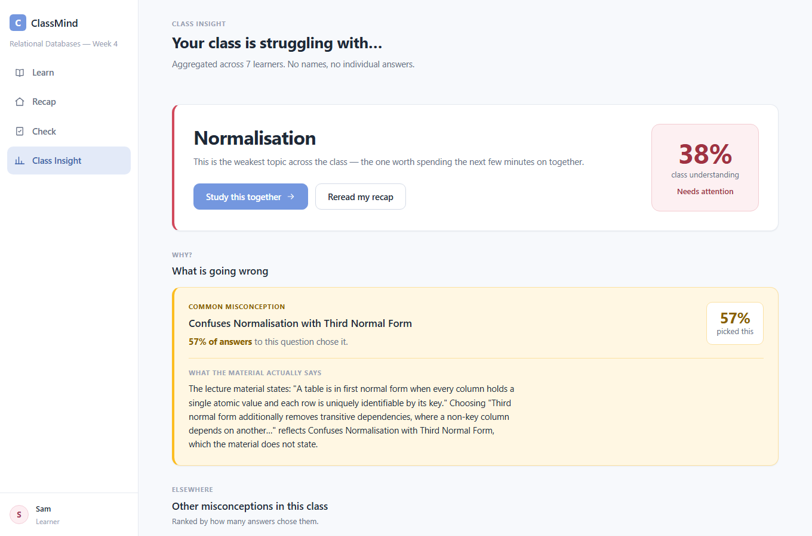
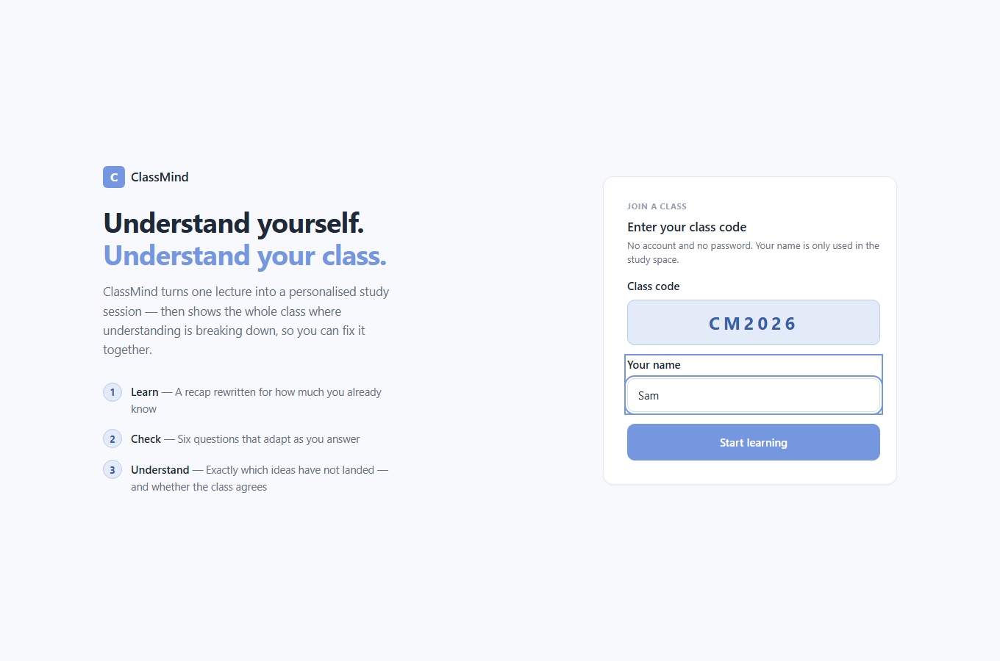
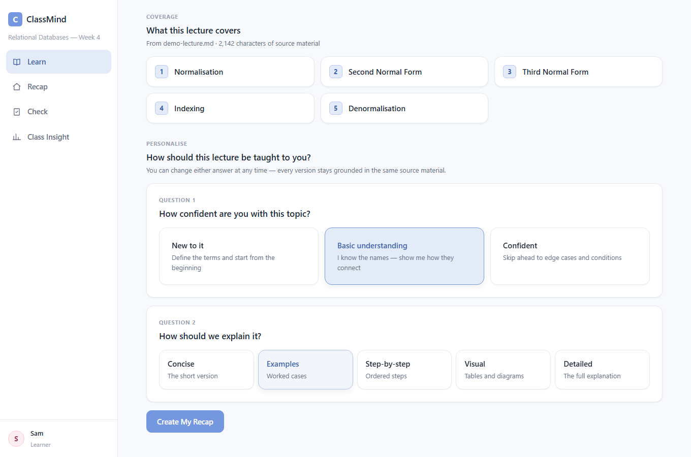
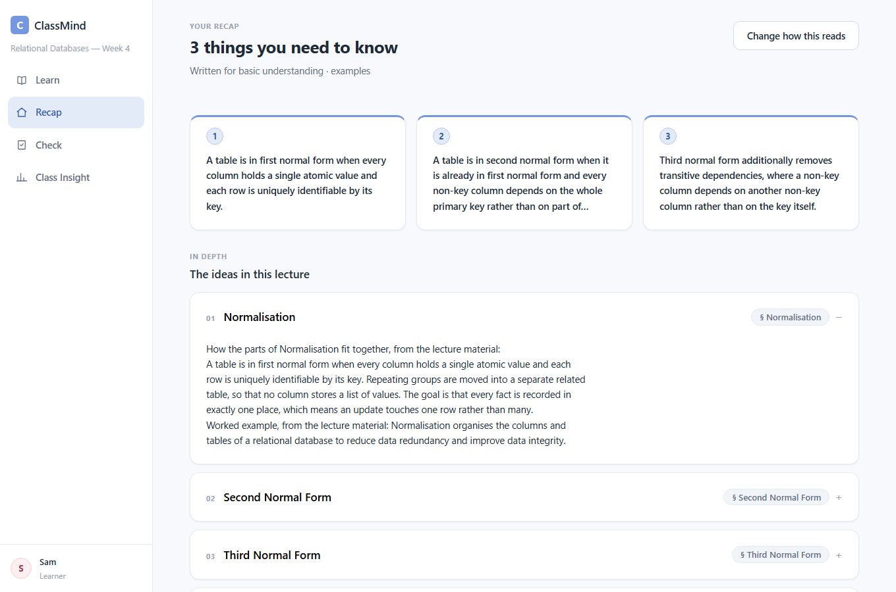
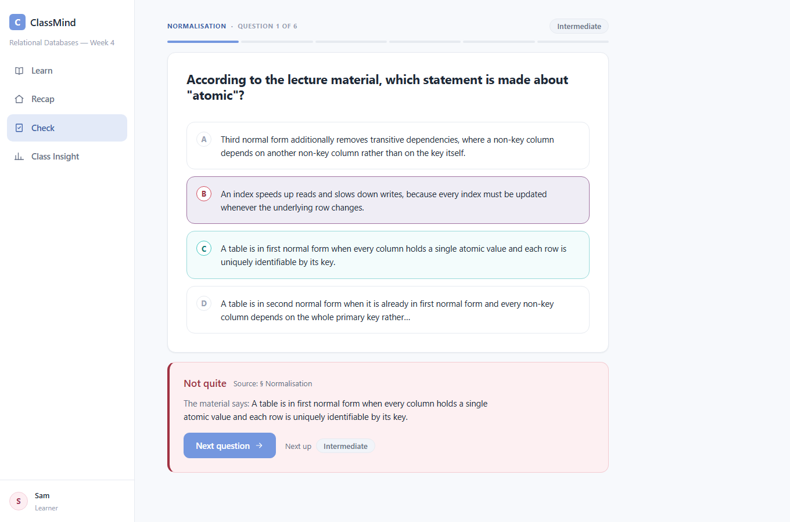
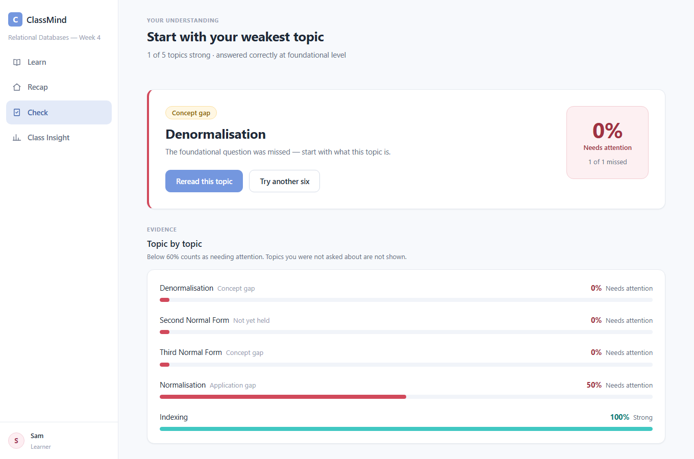
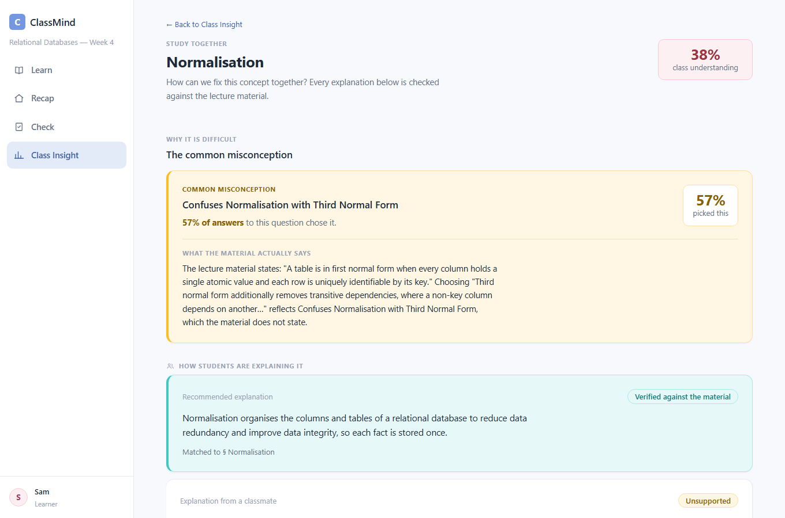

# ClassMind

**Understand yourself. Understand your class.**

ClassMind turns one lecture into a personalised study session — a recap written
for how much you already know, a six-question quiz that adapts as you answer and
a report of which ideas have not landed — then shows the whole class,
anonymously, where understanding is breaking down and which wrong beliefs are
shared.

**Live demo:** <https://classmind-app.vercel.app> — join with class code `CM2026`.

Built for the **AWS Kiro competition** and specified with Kiro.



## The problem

After a lecture, students rarely know which ideas they have actually
understood, and instructors rarely know which ideas the class as a whole has
missed. ClassMind gives each learner a study session shaped to their level, and
turns everyone's quiz answers into an anonymous picture of the class: which
topics are weakest, and which specific wrong answer many people chose.

## Features

- **Personalised recap** — key takeaways and one section per topic, shaped by
  the learner's chosen understanding level and explanation style; every section
  cites the lecture.
- **Adaptive quiz** — six questions; two right in a row raises the difficulty,
  two wrong lowers it. Each answer shows the correct option and its source.
- **Understanding report** — per-topic mastery, weakest topic first.
- **Class Understanding Map** — class mastery per topic, computed from the
  stored answers and hidden until three learners have answered.
- **Misconception detection** — wrong answers chosen by a large share of the
  class, with what the lecture actually says.
- **Study threads** — classmates' explanations, each checked against the
  lecture before it can be recommended.
- **Lecture upload** — PDF, TXT or Markdown; topics, recap and quiz are built
  from the file.

| | |
| --- | --- |
|  |  |
|  |  |
|  |  |

Recaps, questions and explanation checks come from a **deterministic,
rule-based engine that quotes the lecture — not a language model.** The
original design used Amazon Bedrock, which was never enabled; see
[architecture](docs/architecture.md#content-generation).

## Tech stack

Next.js 16 (App Router) · React 19 · TypeScript · PostgreSQL (Neon) via
`node-postgres` · `unpdf` · Vitest, fast-check, PGlite · Playwright · Vercel

## Getting started

Requires **Node.js 22.12+** and npm. No environment variables, database,
Docker, AWS account or API key are needed.

```bash
git clone https://github.com/kwek-na-yi/AWS-Kiro-Classmind.git
cd AWS-Kiro-Classmind
npm install
npm run dev
```

Open <http://localhost:3000>, keep the class code `CM2026`, enter a name and
press **Start learning**. On the first request ClassMind creates its local data
store in `.classmind/` and builds the demo classes.

### Demo classes

All demo content is synthetic.

| Code | Class | Contents |
| --- | --- | --- |
| `CM2026` | Relational Databases — Week 4 | A short lecture ([`lib/demo/demo-lecture.md`](lib/demo/demo-lecture.md)), five topics and six synthetic learners who have already taken the quiz |
| `UPLOAD` | Your own lecture | Empty — upload a file to build a class from it |

`npm run demo:reset` restores both classes, even while the server is running;
`npm run reset:class` empties only `UPLOAD`.
Deleting `.classmind/` has the same effect on the next request.

## Scripts

| Command | Purpose |
| --- | --- |
| `npm run dev` | Development server on port 3000 |
| `npm run build`, `npm start` | Production build and server |
| `npm run demo:reset` | Restore both demo classes |
| `npm run lint`, `npm run typecheck` | ESLint and TypeScript checks |
| `npm test` | Unit, property-based, route and integration tests |
| `npm run test:e2e` | Playwright browser tests against a production build |

Testing in detail: [docs/testing.md](docs/testing.md).

## Project structure

```
app/            pages and API routes (Next.js App Router)
components/     UI components
hooks/          client-side learner identity
lib/
  domain/       quiz, mastery, class-map and misconception rules (pure)
  ai/           rule-based content generation behind a provider interface
  ingest/       text extraction, topics, uploads, lecture-file storage
  repo/         repositories over one PK/SK data model
  store/        storage backends: local JSON, PostgreSQL, optional DynamoDB
  demo/         demo lecture, seeding and reset
  http/         request pipeline, errors, auth, rate limits
scripts/        seed, reset and verification scripts
tests/, e2e/    integration and browser tests
docs/           architecture, configuration, API, deployment, testing
.kiro/specs/    original Kiro requirements, design and task plan
```

## Deployment

The public demo runs on **Vercel** with a free **Neon** PostgreSQL database,
which stores both data and uploaded lecture files, plus a daily automatic reset
and public-demo protections (rate limits, a read-only demo lecture, 4 MB
uploads, security headers). See [docs/deploy-vercel.md](docs/deploy-vercel.md).

## Documentation

| Document | Contents |
| --- | --- |
| [Architecture](docs/architecture.md) | System design, business rules, storage backends, original AWS design |
| [Configuration](docs/configuration.md) | Every environment variable, by environment |
| [API](docs/api.md) | Routes, authentication and error codes |
| [Testing](docs/testing.md) | Test suites, browser tests, testing a deployment |
| [Deploying to Vercel](docs/deploy-vercel.md) | Hosted setup, reset and protections |
| [Optional AWS adapter](docs/aws-setup.md) | Running against DynamoDB and S3 |

## Limitations

- **No language model.** Recaps quote rather than rewrite, and explanation
  checks compare words, not meaning — a correct explanation in very different
  wording can be marked *Unsupported*.
- **No accounts or instructor interface.** Anyone with a class code can join;
  classes other than the two demo classes are created by scripts.
- **The hosted demo is shared.** What a visitor enters is visible to other
  visitors until the daily reset; there is no content moderation.
- **Text-based PDFs only** — there is no OCR.
- The local JSON store is for a single server; hosting uses PostgreSQL.
- The optional AWS adapter and the Dockerfile have not been exercised against
  AWS or rebuilt since the move away from AWS.

## Acknowledgements

Built by the ClassMind team for the AWS Kiro competition. Requirements, design
and the implementation plan were developed with [Kiro](https://kiro.dev) and are
kept in [`.kiro/specs/classmind-mvp/`](.kiro/specs/classmind-mvp/).
